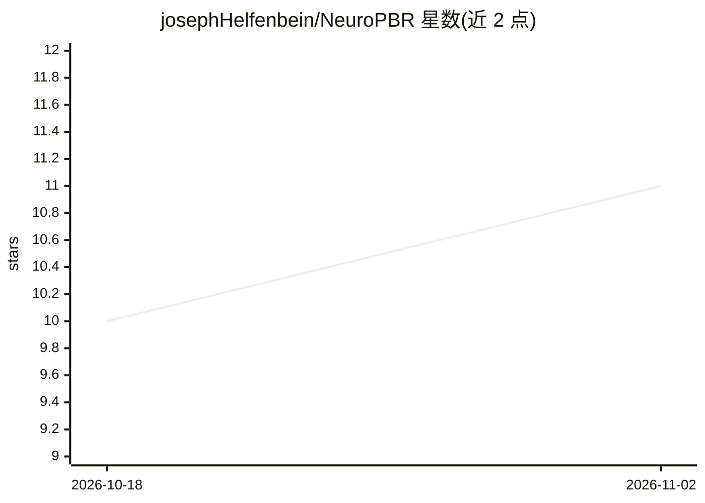

# josephHelfenbein/NeuroPBR

⭐ 11 · Python · Apache-2.0 · 推送 2026-10-13 · [GitHub](https://github.com/josephHelfenbein/NeuroPBR) · 个人维护

**用 iPhone 拍照重建 PBR 材质：完整训练管线+iOS 端侧推理**

端到端的 PBR 材质数字化系统：自研 C++/CUDA 渲染器从 MatSynth 数据集生成带瑕疵/干净配对的训练数据，多视图深度学习网络（ResNet/UNet + Vision Transformer）从三张手持照片重建 albedo、normal、roughness、metallic 贴图；通过知识蒸馏训练 MobileNetV3 学生模型，导出 Core ML 在 iOS 设备端推理，并以 Metal 渲染器实时预览材质。训练管线要求 Linux/WSL2 与 NVIDIA GPU（建议 16GB 显存），移动端为 Flutter iOS 应用，仓库含预编译模型。

## 筛选速览

| 维度 | 判定 | 备注 |
|---|---|---|
| AI 角色 | `ai-native` | 本体是模型或模型工具 |
| 许可风险 | `permissive` | Apache-2.0 |
| 部署形态 | `library` | 以包/库形式分发 |
| 模型依赖 | — | README 未给出锁定关系 |
| 硬件要求 | `gpu-8g` | |
| 安装摩擦 | `high` | 编译与系统依赖俱全 |
| 成熟度 | — | 结构信号不足 |

## 能力要点

- C++/CUDA 合成数据渲染器生成配对训练数据
- 多视图融合网络从三张照片重建四类 PBR 贴图
- 知识蒸馏 + Core ML 导出（FP16、SR 超分、ANE 优化）实现 iOS 端侧推理
- Metal 实时 PBR 预览渲染器

## 适用场景

- 用 iPhone 拍摄表面照片生成可用的 3D PBR 材质
- 从数据准备到模型训练完整复现材质重建管线
- 将自定义训练的学生模型部署到 iOS 设备离线推理

## 场景标签

`模型训练` · 领域:训练与推理

## 证据(README 行号)

> L25: 2. **Deep Learning Pipeline**: A multi-view fusion network (ResNet/UNet + Vision Transformer) trained to reconstruc
> L27: 3. **Mobile Deployment**: An iOS app that runs a distilled "Student" model on-device via Core ML, featuring a real-

## 星数曲线

2026-10-18 10 → 2026-11-02 11（+1）

---
*卡片 v1 · prompt 1.4 · 生成 2026-11-02 · 置信度 mid · 依据 README sha `5a51e96a4f93` · [字段定义](../../DATASET.md)*
