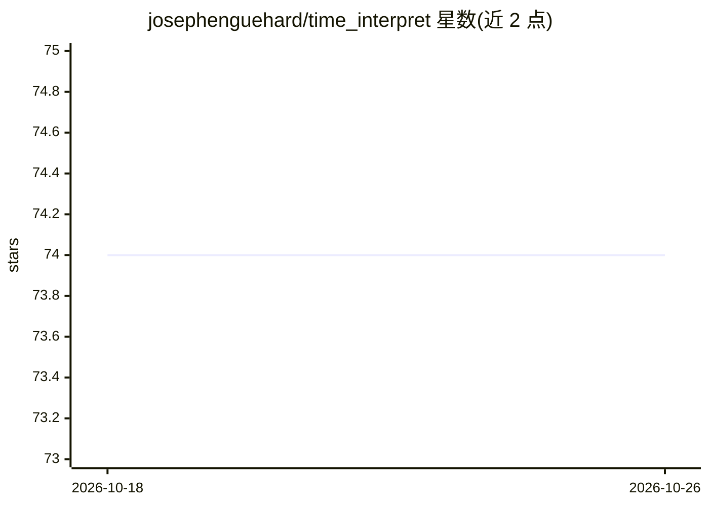

# josephenguehard/time_interpret

⭐ 74 · Python · MIT · 推送 2026-05-18 · [GitHub](https://github.com/josephenguehard/time_interpret) · [官网](https://josephenguehard.github.io/time_interpret/) · 个人维护

**时间序列可解释性库：扩展 captum 的归因分析工具**

基于 captum 扩展的 Python 库，聚焦时间序列预测的模型可解释性：提供 17 种归因方法（TemporalIntegratedGradients、DynaMask、ExtremalMask、BayesLime 等），并附带 ARMA 等数据集、模型与评估指标（如白盒 aup 指标），支持从数据生成、归因计算到评估的完整流程。由研究者团队维护，关联两篇论文（扰动解释与 Sequential Integrated Gradients）并提供实验代码。面向从事时间序列模型解释的开发者与科研人员。

## 筛选速览

| 维度 | 判定 | 备注 |
|---|---|---|
| AI 角色 | `ai-ecosystem` | LLM/agent 周边工具 |
| 许可风险 | `permissive` | MIT |
| 部署形态 | `library` | 以包/库形式分发 |
| 模型依赖 | — | README 未给出锁定关系 |
| 硬件要求 | — | 无带数字的原话,不猜 |
| 安装摩擦 | `low` | 无编译、无系统依赖或容器化 |
| 成熟度 | — | 结构信号不足 |

## 能力要点

- 17 种时间序列归因方法（DynaMask、ExtremalMask、BayesLime 等）
- 内置数据集（Arma 等）、模型与白盒评估指标
- 关联论文并提供 HMM、Mimic3、NLP 实验代码

## 适用场景

- 对时间序列预测模型做归因分析
- 用真实 saliency 评估归因方法质量
- 复现时间序列可解释性相关论文实验

## 场景标签

`科研工具` · 领域:学习与行业

## 证据(README 行号)

> L3: This library expands the captum library with a specific
> L54: - AugmentedOcclusion
> L72: This package also provides several datasets, models and metrics. Please refer to the documentation for more details

## 星数曲线

2026-10-18 74 → 2026-10-26 74（+0）

---
*卡片 v1 · prompt 1.4 · 生成 2026-10-24 · 置信度 high · 依据 README sha `61875ac45586` · [字段定义](../../DATASET.md)*
