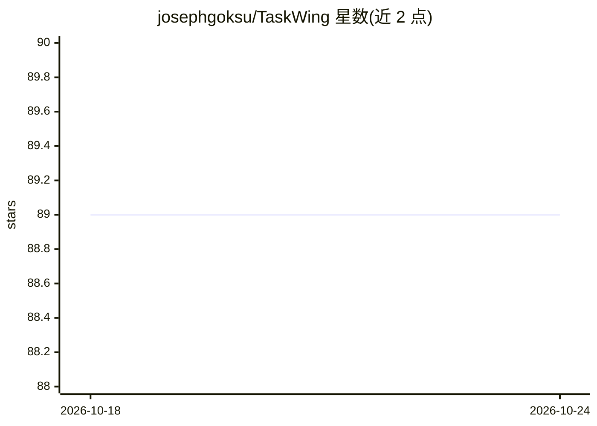

# josephgoksu/TaskWing

⭐ 89 · Go · NOASSERTION · 推送 2026-05-12 · [GitHub](https://github.com/josephgoksu/TaskWing) · [官网](https://taskwing.app) · 个人维护

**本地优先的 AI 开发知识层：抽取架构知识供 AI 工具查询**

用一条命令把代码项目的架构、决策、模式与约束抽取为本地 SQLite 知识库，AI 工具通过 slash 命令调用 taskwing CLI 获取上下文，无 MCP 服务、无守护进程、无网络调用。面向在 Claude Code、Codex、Cursor 等工具中开发并希望代码上下文不出本机的开发者。功能包括知识检索、计划分解为任务、任务生命周期执行、符号搜索与调用图、通过 Claude Code hooks 的自主任务执行（含熔断限制）。兼容多家 LLM 提供商（OpenAI/Anthropic/Gemini/Bedrock/Ollama），MIT 许可。

## 筛选速览

| 维度 | 判定 | 备注 |
|---|---|---|
| AI 角色 | `ai-ecosystem` | LLM/agent 周边工具 |
| 许可风险 | `none` | NOASSERTION |
| 部署形态 | `None` |  |
| 模型依赖 | local-ok | 支持本地模型 |
| 硬件要求 | — | 无带数字的原话,不猜 |
| 安装摩擦 | `low` | 无编译、无系统依赖或容器化 |
| 成熟度 | — | 结构信号不足 |

## 能力要点

- 一条命令抽取架构到本地 SQLite 知识库，无云无账号
- slash 命令为纯 prompt 驱动 CLI，兼容任何可运行 shell 命令的 AI 客户端
- 计划分解为任务及任务生命周期管理（next/start/complete/verify）
- Claude Code hooks 自主任务执行，含 --max-tasks/--max-minutes 熔断机制

## 适用场景

- 让 Claude Code/Cursor 等 AI 助手跨会话记住项目架构决策
- 本地化保存代码知识库，避免上下文流经云端
- 把执行计划分解为带架构上下文的任务并逐步执行

## 场景标签

`Agent 记忆` · 领域:Agent 开发

## 证据(README 行号)

> L19: **TaskWing takes the opposite approach.** One command extracts your architecture into a local knowledge base on you
> L55: Slash commands are pure prompts that drive the `taskwing` CLI directly - no

## 星数曲线

2026-10-18 89 → 2026-10-24 89（+0）

---
*卡片 v1 · prompt 1.4 · 生成 2026-10-23 · 置信度 high · 依据 README sha `fcb6113d5ae5` · [字段定义](../../DATASET.md)*
