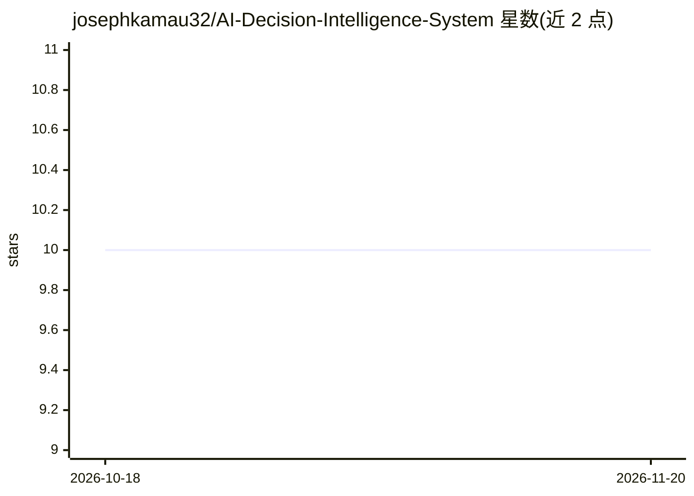

# josephkamau32/AI-Decision-Intelligence-System

⭐ 10 · Python · MIT · 推送 2026-09-08 · [GitHub](https://github.com/josephkamau32/AI-Decision-Intelligence-System) · [官网](https://decisera.vercel.app) · 个人维护

**企业表格数据 AutoML 决策平台：自动训练、SHAP 解释与 AI Copilot**

Decisera 是一个客户端-服务器架构的表格 ML 决策平台：前端 React 18 + TypeScript 部署于 Vercel，后端 FastAPI 提供 JWT 认证的 REST 接口。核心流程为上传 CSV 后自动执行多模型基准训练（XGBoost、LightGBM、CatBoost、RandomForest、Prophet、PyTorch LSTM 共 12+ 算法），配合 Optuna 超参优化、TreeSHAP/KernelSHAP 特征归因可视化、Redis 缓存、MLflow 实验跟踪与 Prometheus 指标，并提供自然语言数据集探索的 AI Copilot。支持 Docker Compose 一键部署与 RBAC 角色控制。

## 筛选速览

| 维度 | 判定 | 备注 |
|---|---|---|
| AI 角色 | `ai-native` | 本体是模型或模型工具 |
| 许可风险 | `permissive` | MIT |
| 部署形态 | `self-host` | docker 或自建部署 |
| 模型依赖 | — | README 未给出锁定关系 |
| 硬件要求 | — | 无带数字的原话,不猜 |
| 安装摩擦 | `low` | 无编译、无系统依赖或容器化 |
| 成熟度 | — | 结构信号不足 |

## 能力要点

- 12+ 算法自动基准训练，覆盖分类、回归与时序任务
- TreeSHAP/KernelSHAP 特征归因与重要性可视化
- AI Copilot 支持自然语言数据集探索
- JWT 认证、RBAC 三级角色与 Docker Compose 编排

## 适用场景

- 上传 CSV 后自动完成表格数据的模型训练与评估
- 通过 SHAP 图表解释模型特征重要性
- 用自然语言对话探索数据集

## 场景标签

`MLOps` `模型训练` `数据分析` · 领域:效率与自动化

## 证据(README 行号)

> L3: > **Enterprise-grade machine learning and decision intelligence platform that automates tabular ML workflows, genera
> L63: 3. **ML Pipeline & MLOps:** Coordinates 12+ ML models (XGBoost, LightGBM, CatBoost, RandomForest, Prophet, PyTorch 

## 星数曲线

2026-10-18 10 → 2026-11-20 10（+0）

---
*卡片 v1 · prompt 1.4 · 生成 2026-11-19 · 置信度 high · 依据 README sha `984fde8f0f23` · [字段定义](../../DATASET.md)*
