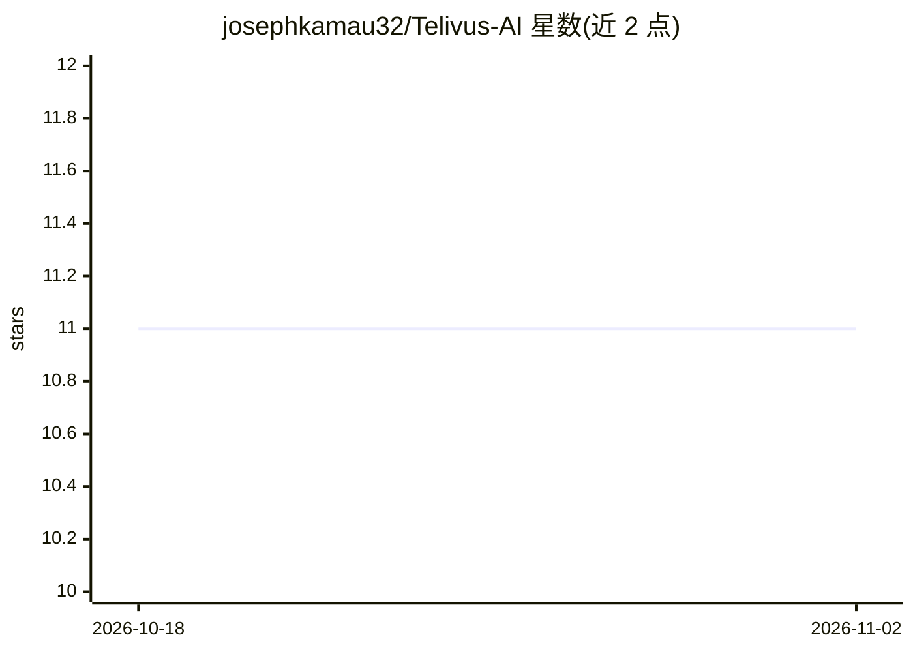

# josephkamau32/Telivus-AI

⭐ 11 · TypeScript · MIT · 推送 2026-09-01 · [GitHub](https://github.com/josephkamau32/Telivus-AI) · [官网](https://telivus.co.ke/) · 个人维护

**AI 健康评估全栈平台：症状分析、追踪与报告生成**

研究原型与工程作品集性质的全栈健康平台，非医疗器械。双层后端：Supabase Edge Functions（Deno/TypeScript）承担实时付费咨询聊天（直连 OpenAI API、Paystack 支付）；FastAPI Python 后端承担症状评估报告生成，使用 GPT-4o-mini、LangChain 多 Agent 路由、ChromaDB RAG 检索与 PyTorch LSTM/Transformer 时间序列预测。内置 CCEE 可解释性子系统（置信度、推理图、安全评分）、GDPR/EU AI Act 合规设计、Langfuse 观测与 RAGAs 评测。6 个 Docker 容器编排部署，提供在线 Demo。

## 筛选速览

| 维度 | 判定 | 备注 |
|---|---|---|
| AI 角色 | `ai-native` | 本体是模型或模型工具 |
| 许可风险 | `permissive` | MIT |
| 部署形态 | `self-host` | docker 或自建部署 |
| 模型依赖 | — | README 未给出锁定关系 |
| 硬件要求 | — | 无带数字的原话,不猜 |
| 安装摩擦 | `low` | 无编译、无系统依赖或容器化 |
| 成熟度 | `idea` | |

## 能力要点

- LangChain 多 Agent 架构（评估/咨询/急诊检测三个专用 Agent）
- CCEE 可解释性子系统：校准置信度、推理图、安全评分与不确定性检测
- 四级降级策略（GPT-4o-mini → 规则引擎 → Redis 缓存 → 保守通用指导）
- GDPR/EU AI Act 合规设计：PII 匿名化、数据最小化、可自托管部署

## 适用场景

- 通过对话式 AI 获取症状评估与结构化医疗报告
- 作为 RAG + 多 Agent 系统的参考架构学习
- 在欧盟合规要求下自托管部署健康评估原型

## 场景标签

`聊天机器人` · 领域:对话与助手

## 证据(README 行号)

> L26: **Telivus AI** is a health platform combining conversational AI consultation, longitudinal health tracking, and aut
> L62: - 🤖 **AI Health Assessment** — Conversational symptom analysis with structured medical reporting, powered by LangCh
> L124: OpenAI GPT-4o-mini Integration

## 星数曲线

2026-10-18 11 → 2026-11-02 11（+0）

---
*卡片 v1 · prompt 1.4 · 生成 2026-11-02 · 置信度 high · 依据 README sha `67ca1eb52df9` · [字段定义](../../DATASET.md)*
