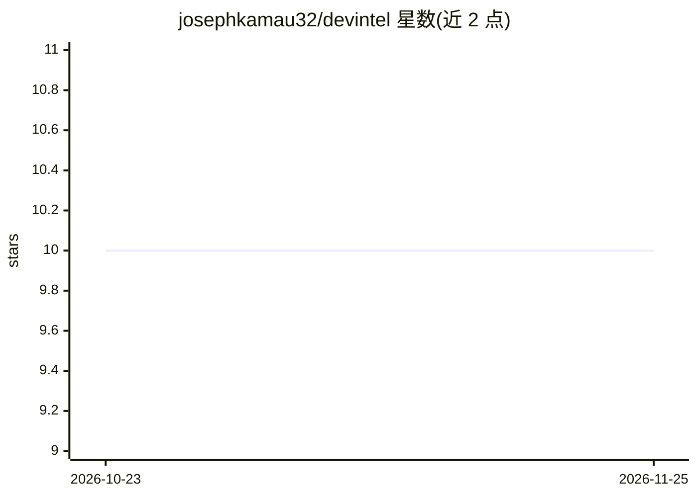

# josephkamau32/devintel

⭐ 10 · Python · MIT · 推送 2026-11-23 · [GitHub](https://github.com/josephkamau32/devintel) · [官网](https://devintel.vercel.app) · 个人维护

**面向开发者的代码库 RAG 问答与代码健康分析平台**

将 GitHub 仓库通过 Tree-sitter AST 切块后写入 PostgreSQL pgvector 向量库，提供基于 RAG 的代码库问答流式聊天、代码健康多维评分（复杂度/文档/可维护性/测试覆盖/安全）、Mermaid 架构图生成与 PR 自动评审及自动修复补丁。Monorepo 包含 FastAPI 后端、React 前端与 VS Code 扩展；默认使用 Google Gemini API，可切换 OpenAI；任务通过 PostgreSQL 表队列异步处理；提供 devintel.vercel.app 公开部署与免 OAuth 的 demo 模式。

## 筛选速览

| 维度 | 判定 | 备注 |
|---|---|---|
| AI 角色 | `ai-native` | 本体是模型或模型工具 |
| 许可风险 | `permissive` | MIT |
| 部署形态 | `self-host` | docker 或自建部署 |
| 模型依赖 | — | README 未给出锁定关系 |
| 硬件要求 | — | 无带数字的原话,不猜 |
| 安装摩擦 | `low` | 无编译、无系统依赖或容器化 |
| 成熟度 | — | 结构信号不足 |

## 能力要点

- AST 感知切块（Tree-sitter）加 pgvector 余弦相似度检索，可选 BM25+RRF 混合检索
- 代码健康评分：总分 0-100 及五个子维度与修复建议
- PR 评审输出结构化 JSON 分级问题，Auto-Fix 循环校验后可自动建分支与 PR
- JWT+Fernet 加密、限流、CSP/HSTS 等安全中间件与 Prometheus 指标

## 适用场景

- 连接 GitHub 仓库后用自然语言提问获得带上下文的代码解答
- 接入仓库索引并自动评审 Pull Request 并生成修复补丁
- 查看仓库架构图与代码健康评分做技术债盘点

## 场景标签

`RAG` `代码审查` · 领域:编码与开发

## 证据(README 行号)

> L5: An asynchronous code intelligence platform that indexes codebases into a PostgreSQL vector database, provides contex
> L59: * **Default AI Provider:** Google Gemini API using `gemini-embedding-001` with Matryoshka dimension reduction to 76
> L92: * **PR Review (`app/services/pr_review_service.py`):** Parses unified Git diffs, retrieves relevant context from in

## 星数曲线

2026-10-23 10 → 2026-11-25 10（+0）

---
*卡片 v1 · prompt 1.4 · 生成 2026-11-19 · 置信度 mid · 依据 README sha `d024eb562446` · [字段定义](../../DATASET.md)*
