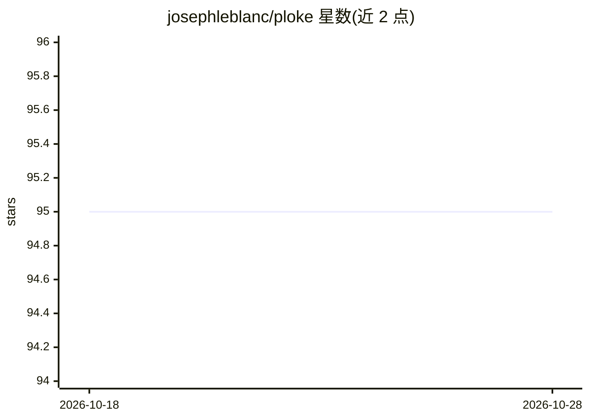

# josephleblanc/ploke

⭐ 95 · Rust · NOASSERTION · 推送 2026-08-02 · [GitHub](https://github.com/josephleblanc/ploke) · [官网](https://ploke.dev/) · 个人维护

**Rust 代码库的终端 LLM 协作工具：向量图索引+语义检索**

面向 Rust 开发者的终端应用（TUI），将代码库解析为向量-图数据库，供 LLM 进行语义搜索、代码查找与编辑。提供 BM25/混合检索、代码图保存加载、staged edit 审批、上下文窗口管理、vim 风格键位与交互式模型选择器。模型接入通过 OpenRouter（默认 kimi-k2），嵌入默认本地 sentence-transformers（CPU）。安装方式为 git clone 后 install.sh 或 cargo build。README 自述处于 Early Alpha 阶段。

## 筛选速览

| 维度 | 判定 | 备注 |
|---|---|---|
| AI 角色 | `ai-ecosystem` | LLM/agent 周边工具 |
| 许可风险 | `none` | NOASSERTION |
| 部署形态 | `None` |  |
| 模型依赖 | locked-api |  |
| 硬件要求 | — | 无带数字的原话,不猜 |
| 安装摩擦 | `medium` | 含编译或系统依赖之一 |
| 成熟度 | `idea` | |

## 能力要点

- 代码库解析为向量-图数据库并支持语义/BM25/混合检索
- staged edit 与文件创建的审批流程，可自动或手动应用
- 模型与嵌入模型选择器覆盖 OpenRouter 全部可用模型
- 原生 cargo test 工具，解析并过滤测试输出供 LLM 使用

## 适用场景

- 在终端中让 LLM 基于代码图理解并修改 Rust 项目
- 通过语义与 BM25 混合检索快速定位相关代码上下文
- 审批制地让模型提交代码编辑

## 场景标签

`RAG` `语义搜索` `编码 Agent` · 领域:编码与开发

## 证据(README 行号)

> L5: Ploke is a Rust-focused terminal-based application for developer-LLM collaboration. It natively parses your rust cod
> L41: After installation, make sure you have `OPENROUTER_API_KEY` set, e.g.

## 星数曲线

2026-10-18 95 → 2026-10-28 95（+0）

---
*卡片 v1 · prompt 1.4 · 生成 2026-10-23 · 置信度 high · 依据 README sha `bfc2be7b1671` · [字段定义](../../DATASET.md)*
