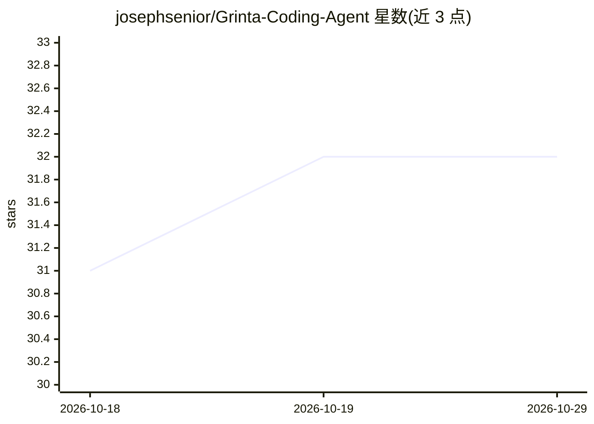

# josephsenior/Grinta-Coding-Agent

⭐ 32 · Python · MIT · 推送 2026-10-27 · [GitHub](https://github.com/josephsenior/Grinta-Coding-Agent) · [官网](https://josephsenior.github.io/Grinta-Coding-Agent/) · 个人维护

**本地优先的自主编码代理，端到端完成长周期软件任务**

面向开发者的终端编码代理：可检查仓库、规划变更、编辑文件、运行命令、调试失败并验证结果，直到任务完成。控制面、命令执行、会话历史与检查点保留在本地机器，推理可用托管服务商或本地模型（Ollama/LM Studio/vLLM）。提供 Chat/Plan/Agent 三种模式与三档自主级别，运行时包含重试、熔断、卡死检测与完成门校验。通过 pipx 安装，要求 Python 3.12/3.13，支持 Linux/Windows/macOS/WSL2。

## 筛选速览

| 维度 | 判定 | 备注 |
|---|---|---|
| AI 角色 | `ai-native` | 本体是模型或模型工具 |
| 许可风险 | `permissive` | MIT |
| 部署形态 | `library` | 以包/库形式分发 |
| 模型依赖 | local-ok | 支持本地模型 |
| 硬件要求 | — | 无带数字的原话,不猜 |
| 安装摩擦 | `low` | 无编译、无系统依赖或容器化 |
| 成熟度 | — | 结构信号不足 |

## 能力要点

- 本地优先：会话状态、执行与检查点保留在本机
- 推理路由支持 OpenAI/Anthropic/Google、OpenRouter、OpenAI 兼容端点及 Ollama/LM Studio/vLLM
- 重试、熔断、卡死检测与完成质量校验的恢复导向执行
- 支持 LSP、DAP、MCP 工具集成与内容寻址的工作区检查点

## 适用场景

- 让代理自主排查并修复失败的测试，完成前跑通相关测试套件
- 在不熟悉的大型仓库中做只读代码理解与变更规划
- 通过管道以非交互方式批量执行编码任务

## 场景标签

`编码 Agent` · 领域:编码与开发

## 证据(README 行号)

> L5:  A local-first coding agent built to finish long, failure-prone software tasks.
> L13: Grinta can inspect a repository, plan a change, edit files, run commands, debug
> L38: |**Inference**|Hosted providers, OpenAI-compatible endpoints, Ollama, LM Studio, and vLLM|

## 星数曲线

2026-10-18 31 → 2026-10-29 32（+1）

---
*卡片 v1 · prompt 1.4 · 生成 2026-10-26 · 置信度 high · 依据 README sha `b6a6708a596c` · [字段定义](../../DATASET.md)*
