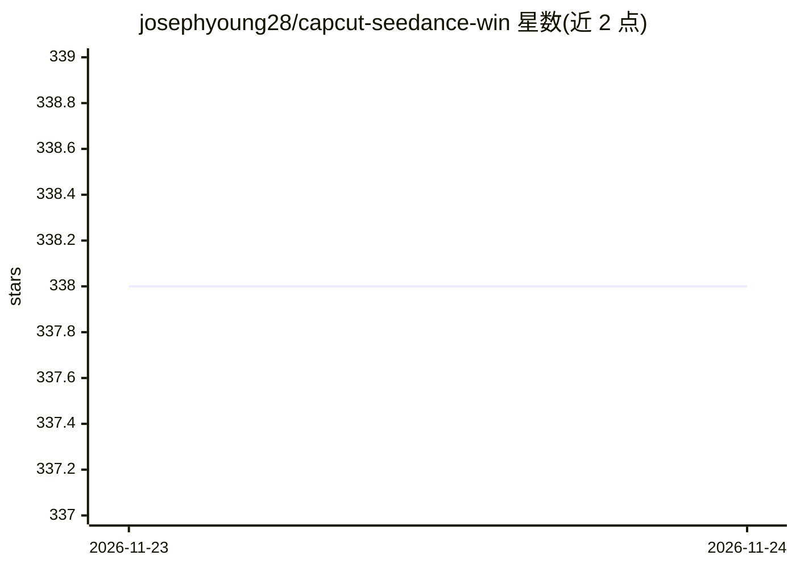

# josephyoung28/capcut-seedance-win

⭐ — · [GitHub]() · 个人维护

**面向 Windows 用户的 CapCut Seedance 文生视频工具安装与使用指南**

一份面向 Windows 10/11 用户的 CapCut Seedance 参考与安装指南：该工具将文本提示词与静态图像转为短视频片段，支持图像动画、运动预设、参考风格迁移与多比例输出，生成结果可直接进入 CapCut 剪辑时间线。文档给出系统要求（x64、8GB 起内存、DirectX 11 与 VC++ 运行库）、五步首跑流程、兼容性说明与 FAQ，需联网激活，许可细节未随文给出。

## 筛选速览

| 维度 | 判定 | 备注 |
|---|---|---|
| AI 角色 | `ai-native` | 本体是模型或模型工具 |
| 许可风险 | `none` | — |
| 部署形态 | `None` |  |
| 模型依赖 | — | README 未给出锁定关系 |
| 硬件要求 | — | 无带数字的原话,不猜 |
| 安装摩擦 | `low` | 无编译、无系统依赖或容器化 |
| 成熟度 | — | 结构信号不足 |

## 能力要点

- 文本生成短视频与静图动画（相机移动、视差、物体运动）
- 运动预设库与参考风格迁移保持画面一致
- 生成片段可直接送入 CapCut 时间线并保留元数据
- 提供 Windows 系统要求、安装与首跑五步流程

## 适用场景

- 为社交平台生成竖屏/方形的短视频片段
- 让产品图或老照片产生受控的动画效果
- 在正式制作前快速产出概念预览与 b-roll 草稿

## 场景标签

`视频生成` `教程课程` · 领域:内容生成

## 证据(README 行号)

> L19: CapCut Seedance is an AI video generation tool built for Windows that turns text prompts and still images into shor
> L42: - **Text-to-Video Synthesis**: Describe a scene in plain language and generate a short clip that follows your promp

## 星数曲线

2026-11-23 338 → 2026-11-24 338（+0）

---
*卡片 v1 · prompt 1.4 · 生成 2026-11-23 · 置信度 high · 依据 README sha `3be3d0b59a52` · [字段定义](../../DATASET.md)*
