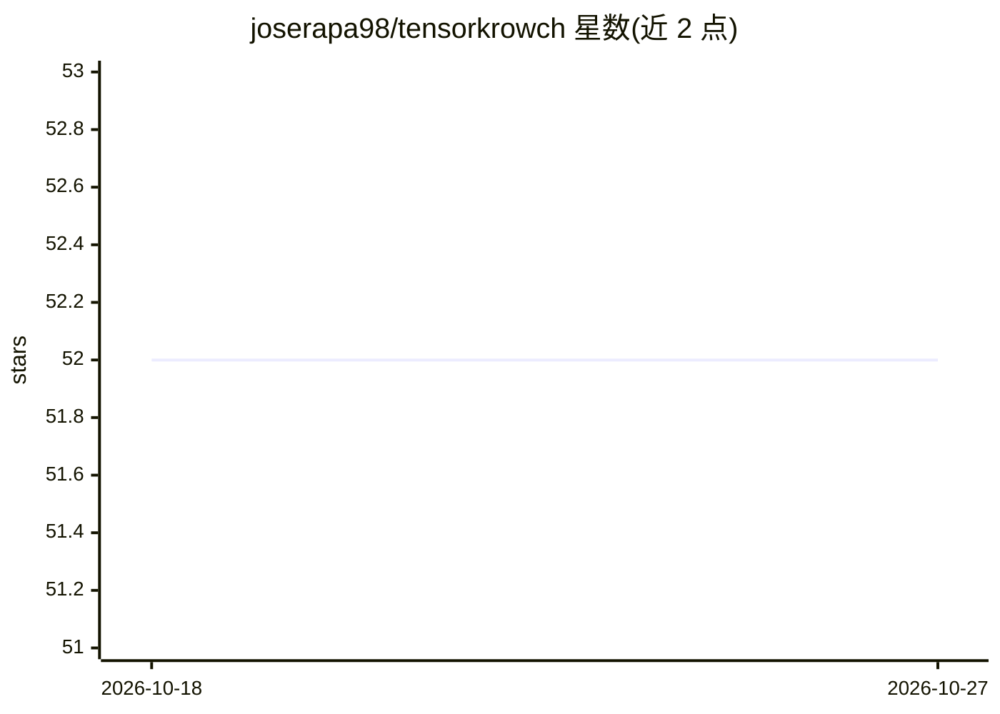

# joserapa98/tensorkrowch

⭐ 52 · Python · MIT · 推送 2026-10-26 · [GitHub](https://github.com/joserapa98/tensorkrowch) · [官网](https://joserapa98.github.io/tensorkrowch/) · 个人维护

**基于 PyTorch 的张量网络构建与训练库，面向机器学习**

TensorKrowch 是构建在 PyTorch 之上的 Python 库，提供 Nodes、Edges、TensorNetworks 等基础组件，用于构建和训练各类张量网络（含 MPS、PEPS 实现），并将其作为 PyTorch 层嵌入深度学习流水线，支持混合神经-张量网络模型与梯度计算。README 说明其定位偏向快速实验与探索合适的张量网络结构，而非所有场景下的最快实现。提供 pip 安装、教程与示例 notebook（含 DMRG 式训练、张量化神经网络等），配有发表在 Quantum 的论文。要求 Python>=3.8、torch>=1.9、opt_einsum>=3.0。

## 筛选速览

| 维度 | 判定 | 备注 |
|---|---|---|
| AI 角色 | `ai-ecosystem` | LLM/agent 周边工具 |
| 许可风险 | `permissive` | MIT |
| 部署形态 | `library` | 以包/库形式分发 |
| 模型依赖 | — | README 未给出锁定关系 |
| 硬件要求 | — | 无带数字的原话,不猜 |
| 安装摩擦 | `low` | 无编译、无系统依赖或容器化 |
| 成熟度 | — | 结构信号不足 |

## 能力要点

- Nodes/Edges/TensorNetworks 基础组件构建任意张量网络，内置 MPS、PEPS 实现
- TensorNetwork 可像 PyTorch 层使用，支持混合神经-张量网络模型
- 支持网络收缩与自动梯度计算
- 提供 7 篇教程与 5 个示例 notebook（如 DMRG 式训练、张量化神经网络）

## 适用场景

- 我想把张量网络作为机器学习模型训练并接入 PyTorch 流水线
- 我想快速实验比较不同张量网络结构再针对性优化
- 我想复现张量网络与机器学习结合的研究成果

## 场景标签

`模型训练` · 领域:训练与推理

## 证据(README 行号)

> L8: **TensorKrowch** is a Python library built on top of **PyTorch** that simplifies
> L9: the training of Tensor Networks as machine learning models and their integration
> L10: into deep learning pipelines.

## 星数曲线

2026-10-18 52 → 2026-10-27 52（+0）

---
*卡片 v1 · prompt 1.4 · 生成 2026-10-24 · 置信度 high · 依据 README sha `6cfef483658c` · [字段定义](../../DATASET.md)*
