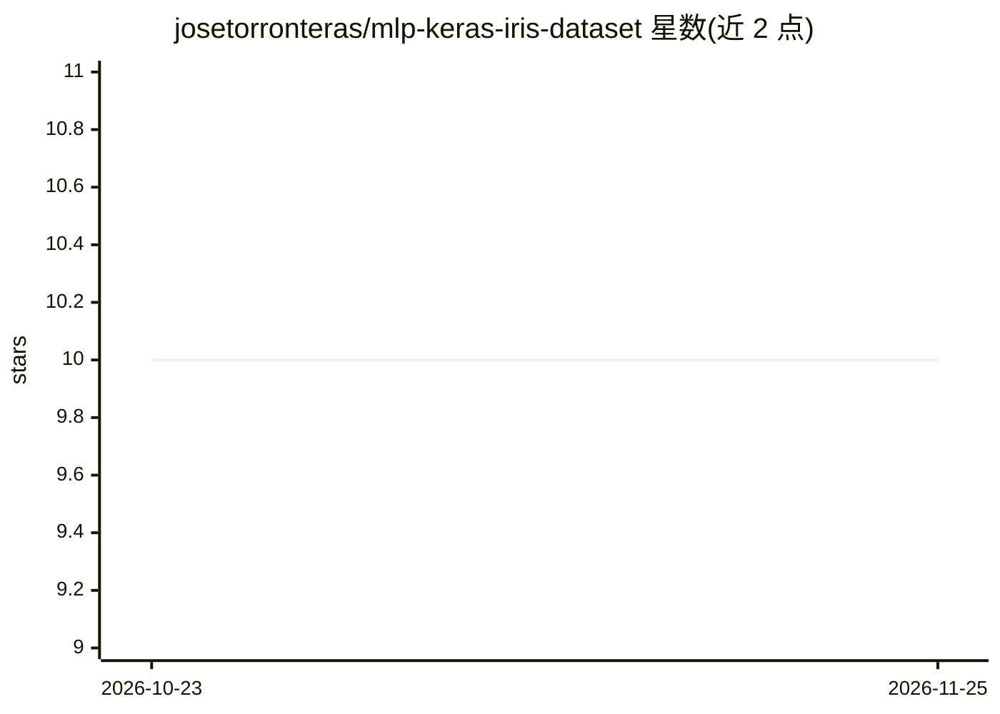

# josetorronteras/mlp-keras-iris-dataset

⭐ 10 · Jupyter Notebook · 推送 2026-11-14 · [GitHub](https://github.com/josetorronteras/mlp-keras-iris-dataset) · [官网](https://colab.research.google.com/github/josetorronteras/mlp-keras-iris-dataset/blob/master/iris.ipynb) · 个人维护

**Keras 构建多层感知机分类 Iris 数据集的教程 notebook**

Jupyter Notebook 教程：使用 Keras 深度学习库构建全连接神经网络（两个隐藏层），对 Iris 花卉数据集进行多分类预测。内容覆盖数据集准备、可视化、模型构建、训练与评估，数据集按训练/测试集划分以测定准确率。面向机器学习入门者，通过 git clone 获取仓库后在虚拟环境中安装依赖并运行 notebook。

## 筛选速览

| 维度 | 判定 | 备注 |
|---|---|---|
| AI 角色 | `ai-native` | 本体是模型或模型工具 |
| 许可风险 | `none` | — |
| 部署形态 | `library` | 以包/库形式分发 |
| 模型依赖 | — | README 未给出锁定关系 |
| 硬件要求 | — | 无带数字的原话,不猜 |
| 安装摩擦 | `low` | 无编译、无系统依赖或容器化 |
| 成熟度 | — | 结构信号不足 |

## 能力要点

- Keras 全连接网络（两个隐藏层）做多分类
- 覆盖数据准备、可视化、训练与评估全流程
- 训练/测试集划分评估模型准确率

## 适用场景

- 入门学习用 Keras 构建神经网络分类器
- 参考多分类任务的数据预处理与可视化流程

## 场景标签

`教程课程` · 领域:学习与行业

## 证据(README 行号)

> L3: Using Keras deep learning library to build a neural network for classifying the Iris flower dataset. The Iris datase
> L5: The notebook provides step-by-step instructions for preparing the dataset, building a neural network using the Keras

## 星数曲线

2026-10-23 10 → 2026-11-25 10（+0）

---
*卡片 v1 · prompt 1.4 · 生成 2026-11-19 · 置信度 high · 依据 README sha `2a1e555d1c8f` · [字段定义](../../DATASET.md)*
