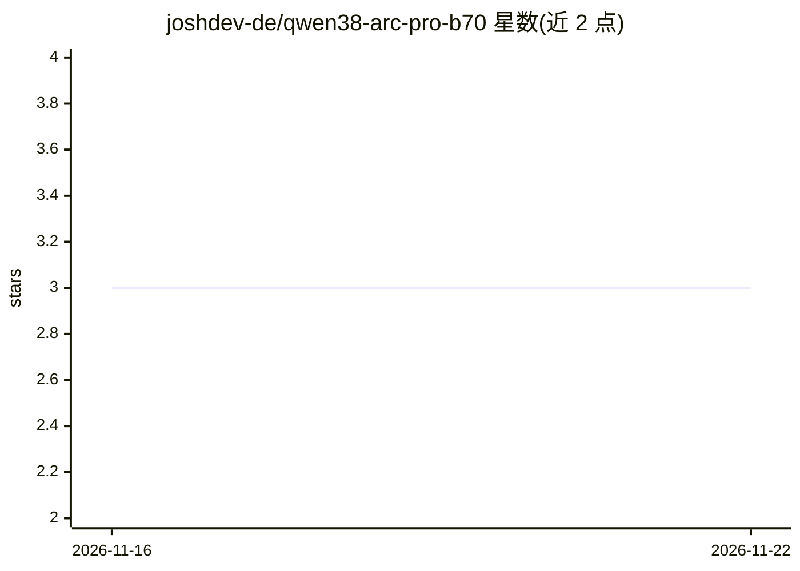

# joshdev-de/qwen38-arc-pro-b70

⭐ 3 · Python · MIT · 推送 2026-11-20 · [GitHub](https://github.com/joshdev-de/qwen38-arc-pro-b70) · 个人维护

**在 Intel Arc Pro B70 上运行 Qwen3.8-27B 的引擎/量化基准与脚本**

针对单张 Intel Arc Pro B70（32 GB）运行 Qwen3.8-27B 的实测仓库：对比 vLLM、llama.cpp（SYCL）、OpenVINO Model Server、Intel llm-scaler 等推理引擎，以及多种 4-bit 量化权重在单客户端与四并发下的解码速度、长 prompt 读取、前缀缓存和工具调用表现；给出推荐配置（引擎镜像、INT4 权重、MTP 3、fp8 缓存、180 W 功耗上限），并提供下载权重、启动服务、金丝雀校验的可复现脚本。面向想在单卡上跑多个并行 agent 的用户，所有数据均在 2026 年 11 月一次 Proxmox 虚拟机环境中测得。

## 筛选速览

| 维度 | 判定 | 备注 |
|---|---|---|
| AI 角色 | `ai-ecosystem` | LLM/agent 周边工具 |
| 许可风险 | `permissive` | MIT |
| 部署形态 | `None` |  |
| 模型依赖 | local-ok | 支持本地模型 |
| 硬件要求 | — | 无带数字的原话,不猜 |
| 安装摩擦 | `medium` | 含编译或系统依赖之一 |
| 成熟度 | — | 结构信号不足 |

## 能力要点

- 四款推理引擎在单卡上的解码/并发/前缀缓存对比数据
- 多种 4-bit 量化权重（INT4/AWQ/GPTQ/AutoRound）的同条件实测
- 提供可复现的启动脚本、金丝雀校验与服务端参数说明
- 功耗上限与风扇故障绕过的实测记录

## 适用场景

- 在 Intel Arc Pro B70 上部署 Qwen3.8-27B 推理服务
- 为并行 agent 工作负载选择引擎与服务端参数
- 复现或参考单卡 4-bit 量化模型的吞吐测试方法

## 场景标签

`推理引擎` `模型量化` · 领域:训练与推理

## 证据(README 行号)

> L3: A measured comparison of inference engines, 4-bit builds and server settings for running
> L71: |Engine|`docker.io/vllm/vllm-openai-xpu:v0.33.0` (upstream vLLM, Intel XPU backend)|
> L108: Requirements: a Linux host with the `xe` driver and a working `/dev/dri` render node, Podman,

## 星数曲线

2026-11-16 3 → 2026-11-22 3（+0）

---
*卡片 v1 · prompt 1.4 · 生成 2026-11-21 · 置信度 high · 依据 README sha `a929c324bb1b` · [字段定义](../../DATASET.md)*
