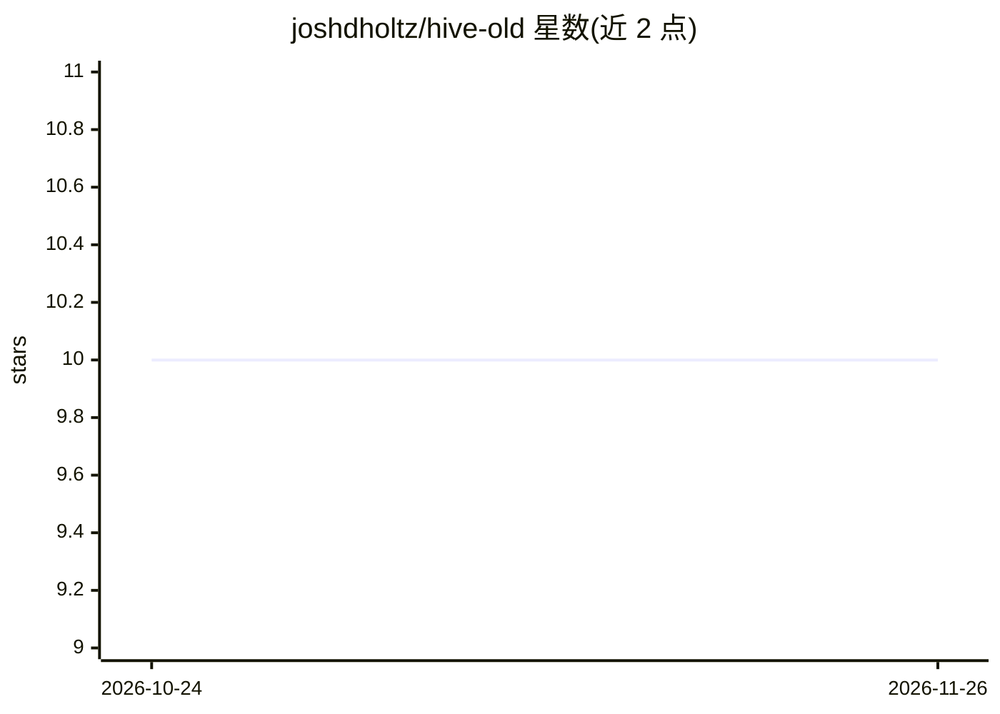

# joshdholtz/hive-old

⭐ 10 · Rust · 推送 2026-01-13 · [GitHub](https://github.com/joshdholtz/hive-old) · 个人维护

**开发者用 TUI 编排多个 Claude/Codex 实例并行开发代码**

Hive 是运行于终端的原生多路复用器，用 architect agent 规划任务并写入任务文件，多个 worker 各占一条 lane 并行执行，watcher 监控任务队列并催促空闲 worker。提供分屏 TUI、worker 分页、命令面板、多项目工作区、git worktree 自动创建与 PR 流程配置。通过 cargo 从源码安装，运行依赖 claude/codex CLI；worker 可配置 skip_permissions 或沙箱模式。

## 筛选速览

| 维度 | 判定 | 备注 |
|---|---|---|
| AI 角色 | `ai-ecosystem` | LLM/agent 周边工具 |
| 许可风险 | `none` | — |
| 部署形态 | `library` | 以包/库形式分发 |
| 模型依赖 | locked-api |  |
| 硬件要求 | — | 无带数字的原话,不猜 |
| 安装摩擦 | `low` | 无编译、无系统依赖或容器化 |
| 成熟度 | — | 结构信号不足 |

## 能力要点

- architect 规划、worker 并行执行、watcher 催促的分工架构
- 内置终端多路复用 TUI，无需 tmux，支持 10+ worker 分页
- 通过 git worktree 为每个 worker 提供独立检出
- 多项目工作区与项目注册表，支持单命令切换

## 适用场景

- 让多个 AI worker 同时处理 api、frontend、tests 等不同 lane 的开发任务
- 在 monorepo 中按子目录分组 worker 并行开发
- 管理多个仓库的工作区并统一编排 agent

## 场景标签

`编码 Agent` `多智能体` `Agent 框架` · 领域:Agent 开发

## 证据(README 行号)

> L5: Hive is a native terminal multiplexer for orchestrating multiple Claude or Codex instances working in parallel. Inst
> L191: - **Architect** — Plans work, researches codebase, writes tasks. Does NOT write code.
> L229: - `claude` CLI and/or `codex` CLI

## 星数曲线

2026-10-24 10 → 2026-11-26 10（+0）

---
*卡片 v1 · prompt 1.4 · 生成 2026-11-19 · 置信度 high · 依据 README sha `01d222b9f83e` · [字段定义](../../DATASET.md)*
