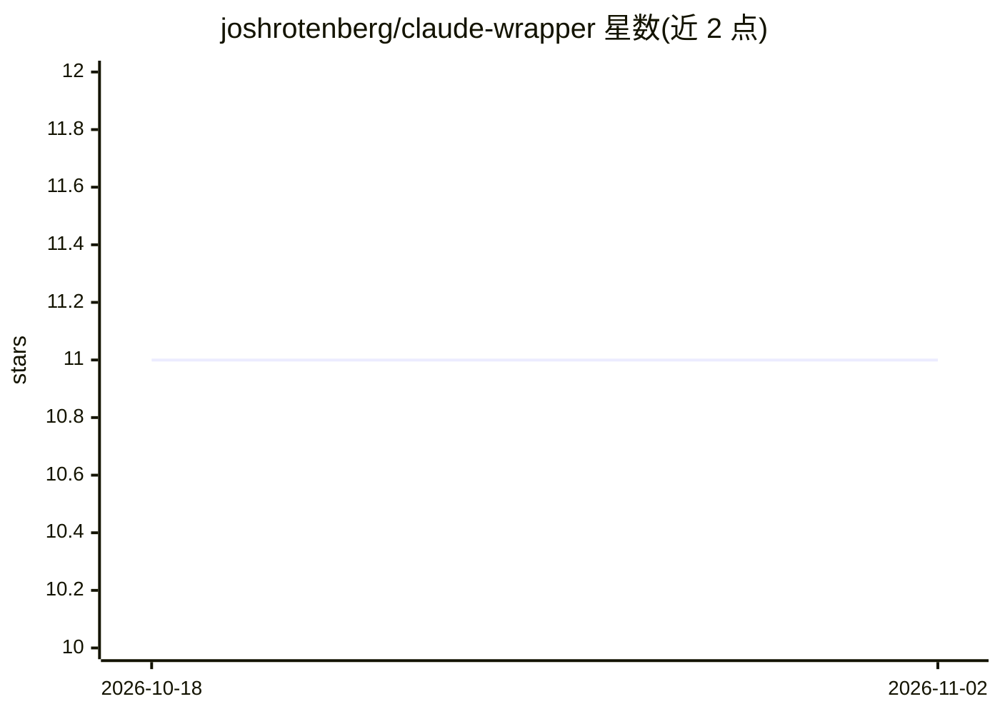

# joshrotenberg/claude-wrapper

⭐ 11 · Rust · Apache-2.0 · 推送 2026-10-29 · [GitHub](https://github.com/joshrotenberg/claude-wrapper) · 个人维护

**面向 Rust 开发者的 Claude Code CLI 类型安全封装库**

Rust 库，以 builder 模式封装 Claude Code CLI：每个子命令对应一个类型化 builder 并产出类型化输出。覆盖 `claude -p` 查询全量选项（模型、系统提示、输出格式、预算、权限模式、JSON Schema 结构化输出等），提供长驻 DuplexSession 与短暂 Session 两种会话形态、NDJSON 流式事件、MCP 服务器管理与插件/市场/认证等子命令，另支持读侧读取 Claude Code 磁盘状态。异步（tokio）与阻塞 API 通过 feature flags 切换。限制：bypass-permissions 模式仅经 env-var 门控的 DangerousClient 提供；子进程环境清理非 OS 级隔离。

## 筛选速览

| 维度 | 判定 | 备注 |
|---|---|---|
| AI 角色 | `ai-ecosystem` | LLM/agent 周边工具 |
| 许可风险 | `permissive` | Apache-2.0 |
| 部署形态 | `library` | 以包/库形式分发 |
| 模型依赖 | locked-api |  |
| 硬件要求 | — | 无带数字的原话,不猜 |
| 安装摩擦 | `low` | 无编译、无系统依赖或容器化 |
| 成熟度 | — | 结构信号不足 |

## 能力要点

- QueryCommand 覆盖 `claude -p` 全量选项，含 JSON Schema 结构化输出
- 长驻 DuplexSession（中途打断/权限决策/广播事件订阅）与短暂 Session（预算追踪硬停）两种会话
- MCP 服务器管理与插件、市场、认证、doctor 等子命令的类型化 builder
- async（tokio）与 blocking 双 API，重试策略、超时、输出上限与进程组清理控制

## 适用场景

- 在 Rust 项目中以类型安全方式调用 Claude Code CLI 完成查询与代码任务
- 为 IDE 后端、agent 服务器或聊天 UI 构建长驻 Claude 会话宿主
- 程序化管理 Claude Code 的 MCP 服务器、插件与认证配置

## 场景标签

`Agent 框架` · 领域:Agent 开发

## 证据(README 行号)

> L3: A type-safe Rust wrapper around the Claude Code CLI.
> L12: `claude-wrapper` gives you a builder-pattern interface for the `claude`
> L20: - Full coverage of `claude -p` via `QueryCommand`

## 星数曲线

2026-10-18 11 → 2026-11-02 11（+0）

---
*卡片 v1 · prompt 1.4 · 生成 2026-11-02 · 置信度 high · 依据 README sha `1f071af16b00` · [字段定义](../../DATASET.md)*
