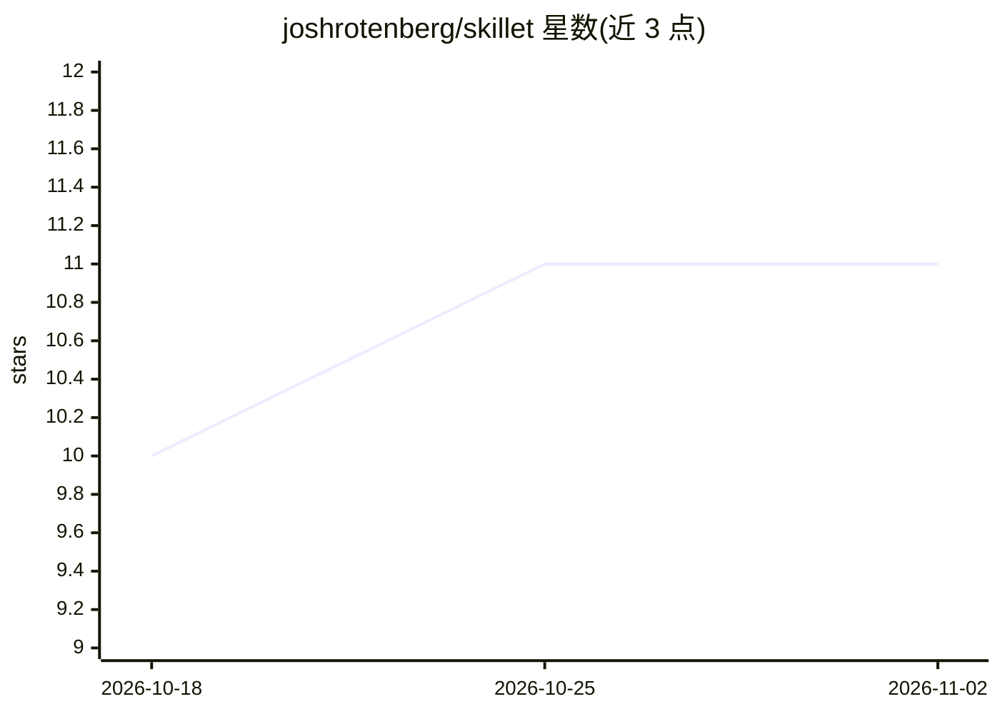

# joshrotenberg/skillet

⭐ 11 · Rust · Apache-2.0 · 推送 2026-03-28 · [GitHub](https://github.com/joshrotenberg/skillet) · 个人维护

**MCP 技能发现服务器：将 SKILL.md 技能以 MCP prompts 提供给 agent**

面向 AI agent 的技能发现与分发工具：索引 git 仓库中的 SKILL.md 文件，通过 MCP prompts（prompts/list、prompts/get）在运行时向 agent 提供技能，无需安装或重启；同时提供 CLI 用于搜索（BM25 全文检索）、浏览分类与管理技能仓库。技能遵循 Agent Skills 规范，兼容 Claude Code、Cursor、Copilot、Windsurf、Gemini CLI 等 agent。支持多仓库聚合、suggest graph 去中心化发现（带跳数信任层级）、skillet.toml 项目内嵌技能与磁盘缓存。以 Rust 实现，提供 Homebrew、cargo、Docker 与预编译二进制安装方式。

## 筛选速览

| 维度 | 判定 | 备注 |
|---|---|---|
| AI 角色 | `ai-ecosystem` | LLM/agent 周边工具 |
| 许可风险 | `permissive` | Apache-2.0 |
| 部署形态 | `desktop` | 安装包/桌面程序 |
| 模型依赖 | — | README 未给出锁定关系 |
| 硬件要求 | — | 无带数字的原话,不猜 |
| 安装摩擦 | `low` | 无编译、无系统依赖或容器化 |
| 成熟度 | — | 结构信号不足 |

## 能力要点

- 将索引技能注册为 MCP prompt，运行时热同步并发 prompts/list_changed 通知
- BM25 全文检索，覆盖名称/描述/分类/标签与 SKILL.md 内容
- suggest graph 去中心化发现，默认接入官方仓库及 14 个社区/厂商仓库
- skillet.toml 支持在任意项目中内嵌单个或多个技能

## 适用场景

- 让我的 coding agent 按任务即时搜索并加载社区技能
- 团队自建技能仓库并聚合到 agent 的 MCP 配置
- 在项目仓库中随代码分发 agent 技能

## 场景标签

`Agent 框架` · 领域:Agent 开发

## 证据(README 行号)

> L9: MCP-native skill discovery for AI agents.
> L13: Skillet serves agent skills as MCP prompts. Your agent connects,
> L25: and work with Claude Code, Cursor, Copilot, Windsurf, Gemini CLI, and

## 星数曲线

2026-10-18 10 → 2026-11-02 11（+1）

---
*卡片 v1 · prompt 1.4 · 生成 2026-11-02 · 置信度 high · 依据 README sha `330447185723` · [字段定义](../../DATASET.md)*
