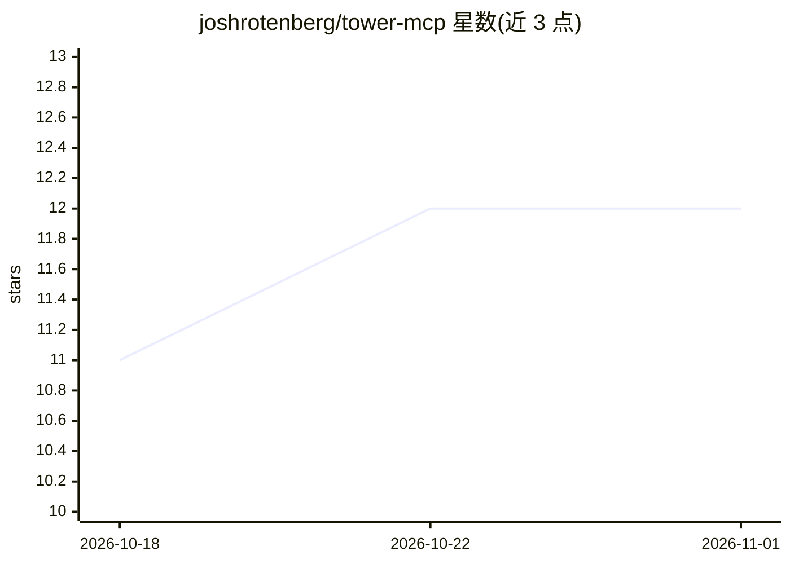

# joshrotenberg/tower-mcp

⭐ 12 · Rust · Apache-2.0 · 推送 2026-10-29 · [GitHub](https://github.com/joshrotenberg/tower-mcp) · [官网](https://docs.rs/tower-mcp) · 个人维护

**基于 Tower 的 Rust MCP 协议实现库**

以 Rust 编写的 Model Context Protocol（MCP）实现，构建于 Tower 之上：MCP 服务器即 tower::Service，可用标准 tower 中间件（tracing、超时、限流、auth）按层组合到整个服务器或单个工具。同一 McpRouter 可通过 stdio、HTTP(SSE)、WebSocket、Unix domain socket 等传输提供服务，HTTP/WebSocket 传输为 axum router，可嵌入现有 axum 应用。支持客户端连接其他 MCP 服务器、OAuth 2.1 资源服务器/客户端、多服务器聚合代理等，以 crate 形式经 Cargo 安装，MSRV 1.90，MIT OR Apache-2.0 双许可。

## 筛选速览

| 维度 | 判定 | 备注 |
|---|---|---|
| AI 角色 | `ai-ecosystem` | LLM/agent 周边工具 |
| 许可风险 | `permissive` | Apache-2.0 |
| 部署形态 | `library` | 以包/库形式分发 |
| 模型依赖 | — | README 未给出锁定关系 |
| 硬件要求 | — | 无带数字的原话,不猜 |
| 安装摩擦 | `low` | 无编译、无系统依赖或容器化 |
| 成熟度 | — | 结构信号不足 |

## 能力要点

- MCP 服务器即 tower::Service，中间件以 .layer() 组合
- 同一 router 支持 stdio/HTTP(SSE)/WebSocket/Unix socket 多种传输
- 实现 2025-03-26 至 2026-07-28 多版本协议，官方 conformance 套件全通过
- 提供 OAuth 2.1 资源服务器与客户端、多服务器聚合代理等 feature

## 适用场景

- 在 Rust 中构建 MCP 服务器或客户端
- 把 MCP 能力嵌入现有 axum Web 应用
- 通过 tower 中间件为 MCP 工具统一加限流、鉴权、tracing
- 搭建聚合多个 MCP 服务器的代理

## 场景标签

 · 领域:LLM 基础设施/协议库

## 证据(README 行号)

> L12: A Model Context Protocol (MCP) implementation for Rust
> L15: An MCP server is a `tower::Service`, so standard tower middleware (tracing, metrics,

## 星数曲线

2026-10-18 11 → 2026-11-01 12（+1）

---
*卡片 v1 · prompt 1.4 · 生成 2026-11-01 · 置信度 high · 依据 README sha `f214be8a3872` · [字段定义](../../DATASET.md)*
