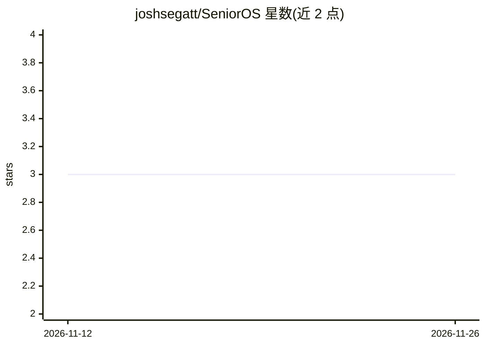

# joshsegatt/SeniorOS

⭐ 3 · JavaScript · Apache-2.0 · 推送 2026-11-16 · [GitHub](https://github.com/joshsegatt/SeniorOS) · [官网](https://www.npmjs.com/package/senioros) · 个人维护

**为编程 agent 提供技能与钩子的工程纪律工具包**

以 Claude Code 插件与 CLI 形式分发的编程 agent 增强包：通过技能、路由规则、破坏性命令守卫与完成门，让 agent 在声明完成前运行项目检查、修复根因而非报告处、危险操作先询问。附带可复跑的基准评测（evals/bench/），可接入任意 Claude Code 插件作为对照臂。支持 Claude Code、Codex、Cursor、OpenCode、Antigravity、Grok CLI 六种安装目标，也可只装技能。需 Node.js 20 以上。

## 筛选速览

| 维度 | 判定 | 备注 |
|---|---|---|
| AI 角色 | `ai-ecosystem` | LLM/agent 周边工具 |
| 许可风险 | `permissive` | Apache-2.0 |
| 部署形态 | `library` | 以包/库形式分发 |
| 模型依赖 | — | README 未给出锁定关系 |
| 硬件要求 | — | 无带数字的原话,不猜 |
| 安装摩擦 | `low` | 无编译、无系统依赖或容器化 |
| 成熟度 | — | 结构信号不足 |

## 能力要点

- 破坏性命令守卫与完成门：检查未通过不得声明 done
- 风险自适应流程：按任务类型区分验证强度（改按钮到生产迁移）
- 附带可复跑基准，支持接入自定义插件作对照臂
- 提供六种编程 agent 的适配安装器

## 适用场景

- 让 Claude Code 修复根因在其他模块的 bug
- 防止 agent 未经确认执行 force-push 等破坏性命令
- 为自己的技能包跑对比基准并查看排行榜

## 场景标签

`编码 Agent` `代码审查` `模型评测` · 领域:编码与开发

## 证据(README 行号)

> L9:  Skills and hooks that make coding agents fix the cause, keep your history safe and prove the work.
> L134: Requires Node.js 20 or newer. No clone needed: the CLI is published on npm as `senioros`, and its command is `seni
> L138: **Claude Code** (the plugin brings the skills, the routing rules, the destructive-command guard and the finish gat

## 星数曲线

2026-11-12 3 → 2026-11-26 3（+0）

---
*卡片 v1 · prompt 1.4 · 生成 2026-11-21 · 置信度 high · 依据 README sha `6497fa05bf07` · [字段定义](../../DATASET.md)*
