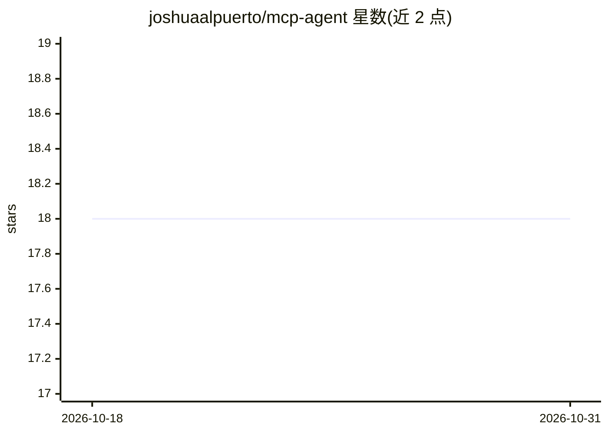

# joshuaalpuerto/mcp-agent

⭐ 18 · TypeScript · 推送 2026-02-28 · [GitHub](https://github.com/joshuaalpuerto/mcp-agent) · 个人维护

**TypeScript 的 MCP Agent 构建框架：管理 MCP 连接并执行工具**

受 lastmile-ai/mcp-agent Python 项目启发的 TypeScript 框架，用于在 JavaScript/TypeScript 环境中构建基于 Model Context Protocol 的 AI Agent。核心机制为两层架构：全局 MCPConnectionManager 管理全部 MCP 服务器连接（支持 stdio/sse/streamable-http/websockets 传输），每个 Agent 配置专属 MCPServerAggregator 提供工具访问。支持本地函数工具、内存消息历史与 Orchestrator 多 Agent 编排（其他工作流模式标注为开发中），LLM 集成以 Fireworks AI 为示例实现。经 npm 安装，附独立运行与 Express 集成示例。

## 筛选速览

| 维度 | 判定 | 备注 |
|---|---|---|
| AI 角色 | `ai-ecosystem` | LLM/agent 周边工具 |
| 许可风险 | `none` | — |
| 部署形态 | `library` | 以包/库形式分发 |
| 模型依赖 | — | README 未给出锁定关系 |
| 硬件要求 | — | 无带数字的原话,不猜 |
| 安装摩擦 | `low` | 无编译、无系统依赖或容器化 |
| 成熟度 | — | 结构信号不足 |

## 能力要点

- 两层架构：全局 MCP 连接管理器 + 每 Agent 工具聚合器，连接复用
- 支持 stdio/sse/streamable-http/websockets 四种 MCP 传输方式
- 本地函数工具与 MCP 服务器工具混合使用
- Orchestrator 多 Agent 协调工作流；Prompt chaining 等模式标注 coming soon

## 适用场景

- 在 TypeScript 项目中构建可调用 MCP 服务器工具的 AI Agent
- 多 Agent 共享 MCP 连接、按需隔离工具访问
- 以 Fireworks AI 为起点扩展接入其他 LLM 提供商

## 场景标签

`Agent 框架` `多智能体` · 领域:Agent 开发

## 证据(README 行号)

> L5: **mcp-agent** is a TypeScript framework inspired by the Python lastmile-ai/mcp-agent project. It provides a simple, 
> L19: * **Model Context Protocol (MCP) Integration:** Seamlessly connect and interact with services and tools exposed thr
> L59: * **MCP Server Aggregator (`MCPServerAggregator`):** Manages the tools available to each individual agent. Each age

## 星数曲线

2026-10-18 18 → 2026-10-31 18（+0）

---
*卡片 v1 · prompt 1.4 · 生成 2026-10-29 · 置信度 mid · 依据 README sha `92c6e2b2fdd0` · [字段定义](../../DATASET.md)*
