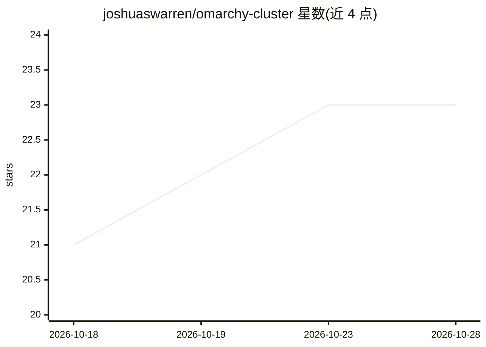

# joshuaswarren/omarchy-cluster

⭐ 23 · Python · MIT · 推送 2026-10-25 · [GitHub](https://github.com/joshuaswarren/omarchy-cluster) · 个人维护

**跨多台 Apple Silicon 机器分布式运行单个本地 MLX/GGUF 模型的推理集群工具**

面向家庭多机环境的分布式 LLM 推理工具：通过 mDNS 发现局域网节点，测量节点间路由，按各节点显存规划层分配，以流水线并行方式把一个模型拆分到多台 Mac（macOS 或 Omarchy M+ Linux，甚至 iPhone）上运行，并对外提供 :8020 端口的 OpenAI 兼容接口。支持 mlx、llama.cpp RPC、Sushi 三种引擎。限制：单请求串行、仅支持 greedy 采样（非零 temperature 请求被拒）、局域网明文 HTTP 无 TLS。各节点经 pip 从 GitHub 安装，节点代理监听 :8025 并以集群令牌认证。

## 筛选速览

| 维度 | 判定 | 备注 |
|---|---|---|
| AI 角色 | `ai-ecosystem` | LLM/agent 周边工具 |
| 许可风险 | `permissive` | MIT |
| 部署形态 | `library` | 以包/库形式分发 |
| 模型依赖 | local-ok | 支持本地模型 |
| 硬件要求 | — | 无带数字的原话,不猜 |
| 安装摩擦 | `medium` | 含编译或系统依赖之一 |
| 成熟度 | — | 结构信号不足 |

## 能力要点

- 自动发现节点、测速路由并做层分配规划（pipeline 并行分片）
- 提供 OpenAI 兼容端点（:8020）
- 三种引擎：MLX（Metal/Vulkan）、llama.cpp RPC（含 iPhone 节点）、Sushi EXL3
- guard 监控节点内存并在越过安全阈值时停止

## 适用场景

- 单个模型放不进任何一台机器时，跨多台 Mac 联合运行
- 把多台家用 Mac 组成一个本地 OpenAI 兼容推理服务
- 用 iPhone 作为 llama.cpp RPC 节点参与推理

## 场景标签

`推理引擎` · 领域:训练与推理

## 证据(README 行号)

> L3: omarchy-cluster runs one local model across the machines on your network: Macs on
> L29: plans, launches one pipeline rank per node through its token-authed agent, and
> L121: `serve` prints the plan, starts the ranks through each node's agent, and leaves

## 星数曲线

2026-10-18 21 → 2026-10-28 23（+2）

---
*卡片 v1 · prompt 1.4 · 生成 2026-10-27 · 置信度 mid · 依据 README sha `83aaa1b902d0` · [字段定义](../../DATASET.md)*
