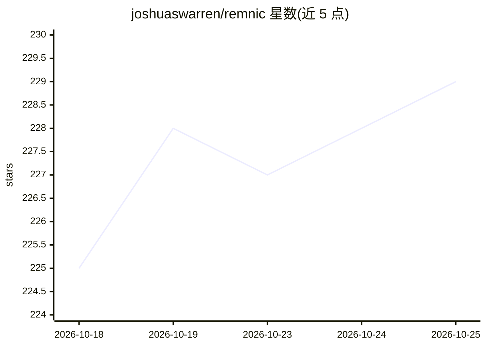

# joshuaswarren/remnic

⭐ 229 · TypeScript · MIT · 推送 2026-10-25 · [GitHub](https://github.com/joshuaswarren/remnic) · [官网](https://remnic.ai) · 个人维护

**本地优先的 AI agent 共享记忆与上下文存储**

面向 AI agent 的开源记忆层：以纯 markdown+YAML 文件为唯一事实源，无数据库与云依赖；通过 MCP/HTTP 与原生插件让 Claude Code、Codex CLI、Cursor、OpenClaw、Hermes 等多种工具共享同一记忆库。机制包括会话自动抽取与召回、BM25+向量+重排序的混合检索、记忆价值评分、来源溯源（provenance）、时序取代与人工审批的纠错流程。README 另展示两个活动作品：支持护照（What Helps Me）与纠错回路（Remnic Relay）。MIT 许可，以 npm/git 方式安装。

## 筛选速览

| 维度 | 判定 | 备注 |
|---|---|---|
| AI 角色 | `ai-ecosystem` | LLM/agent 周边工具 |
| 许可风险 | `permissive` | MIT |
| 部署形态 | `library` | 以包/库形式分发 |
| 模型依赖 | — | README 未给出锁定关系 |
| 硬件要求 | — | 无带数字的原话,不猜 |
| 安装摩擦 | `low` | 无编译、无系统依赖或容器化 |
| 成熟度 | — | 结构信号不足 |

## 能力要点

- 记忆以 markdown+YAML 文件存储于本地磁盘，索引可从文件完全重建
- 跨工具共享同一记忆库：Claude Code、Codex CLI、Cursor、OpenClaw、Hermes 及任意 MCP 客户端
- 混合检索（BM25+向量+重排序）+ 图召回 + 记忆价值评分 + 逐条来源溯源
- 人工审批的纠错回路（Remnic Relay）：证据 X-Ray、记忆 diff、旧信念标记为已取代、新 agent 验证传播

## 适用场景

- 让多个 AI 编码助手记住我的偏好、项目与决策，无需每次重述
- 在调试与研究工作之间保留上下文，避免重复踩坑
- 对 agent 记忆中的过时信念做人工审批的纠正并验证传播
- 本地管理 agent 记忆文件，用 grep/git 直接查看与版本控制

## 场景标签

`Agent 记忆` · 领域:Agent 开发

## 证据(README 行号)

> L7: Open-source, local-first memory and context for AI agents. One memory store, every agent.
> L13: - **Automatic extraction and recall.** Remnic watches conversations, distills durable knowledge, and injects the ri
> L14: - **Sharp retrieval.** Hybrid search (BM25 + vector + reranking) over rebuildable indexes, with graph recall, memor
> L232: |Remnic|Local-first|Free (MIT)|Native plugins for Claude Code, Codex CLI, Pi, OpenClaw, Hermes, plus any MCP clien

## 星数曲线

2026-10-18 225 → 2026-10-25 229（+4）

---
*卡片 v1 · prompt 1.4 · 生成 2026-10-22 · 置信度 mid · 依据 README sha `42e3abd5443f` · [字段定义](../../DATASET.md)*
