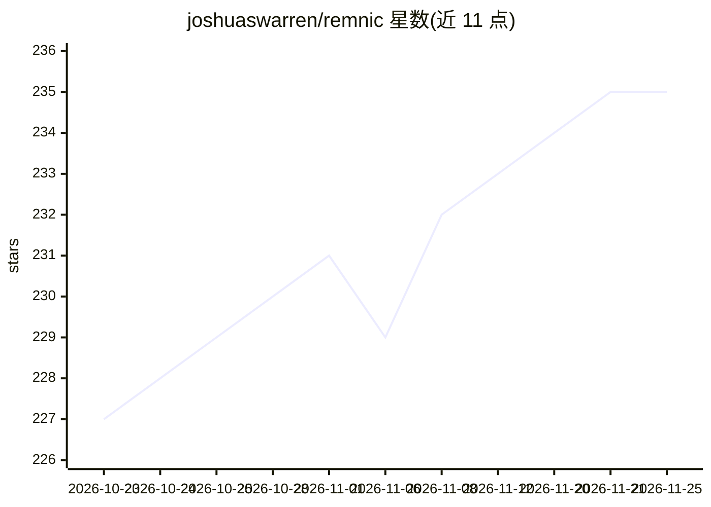

# joshuaswarren/remnic

⭐ 235 · TypeScript · MIT · 推送 2026-11-23 · [GitHub](https://github.com/joshuaswarren/remnic) · [官网](https://remnic.ai) · 个人维护

**给 AI agent 提供本地化共享记忆与上下文存储**

本地优先的 agent 记忆层：记忆以带 YAML frontmatter 的 markdown 文件存于磁盘，附本地 JSON 与 SQLite 状态，不依赖外部数据库服务。自动从对话中提取持久知识并在需要时注入上下文；检索采用 BM25+向量+重排序的混合搜索，含图谱召回、记忆价值评分与逐条来源追溯，索引可从磁盘重建。同一存储可被多个 agent 与 MCP 客户端读写，纠错走人工审批的版本化 supersession 流程，并提供评测基准框架。

## 筛选速览

| 维度 | 判定 | 备注 |
|---|---|---|
| AI 角色 | `ai-ecosystem` | LLM/agent 周边工具 |
| 许可风险 | `permissive` | MIT |
| 部署形态 | `library` | 以包/库形式分发 |
| 模型依赖 | — | README 未给出锁定关系 |
| 硬件要求 | — | 无带数字的原话,不猜 |
| 安装摩擦 | `low` | 无编译、无系统依赖或容器化 |
| 成熟度 | — | 结构信号不足 |

## 能力要点

- markdown 文件即事实源，索引可重建，支持 cat/grep/版本控制
- 一个记忆存储被 OpenClaw、Claude Code、Cursor、ChatGPT 等多工具共享读写
- 混合检索（BM25+向量+重排序）与记忆价值评分、时间性 supersession
- 人工审批的纠错回路（Relay），带证据链与传播验证

## 适用场景

- 让多个编码/对话 agent 共享同一份用户偏好与项目知识
- 记录并复用跨会话的调试结论与研究上下文
- 对 agent 的过时记忆做人工审批式纠错并验证传播

## 场景标签

`Agent 记忆` · 领域:Agent 开发

## 证据(README 行号)

> L7: Open-source, local-first memory and context for AI agents. One memory store, every agent.
> L29: - **One memory across every tool.** OpenClaw, Claude Code, Codex CLI, Cursor, ChatGPT (developer mode), Hermes, Rep
> L31: - **Sharp retrieval.** Hybrid search (BM25 + vector + reranking) over rebuildable indexes, with graph recall, memor

## 星数曲线

2026-10-23 227 → 2026-11-25 235（+8）

---
*卡片 v1 · prompt 1.4 · 生成 2026-11-25 · 置信度 mid · 依据 README sha `2595ab05b908` · [字段定义](../../DATASET.md)*
