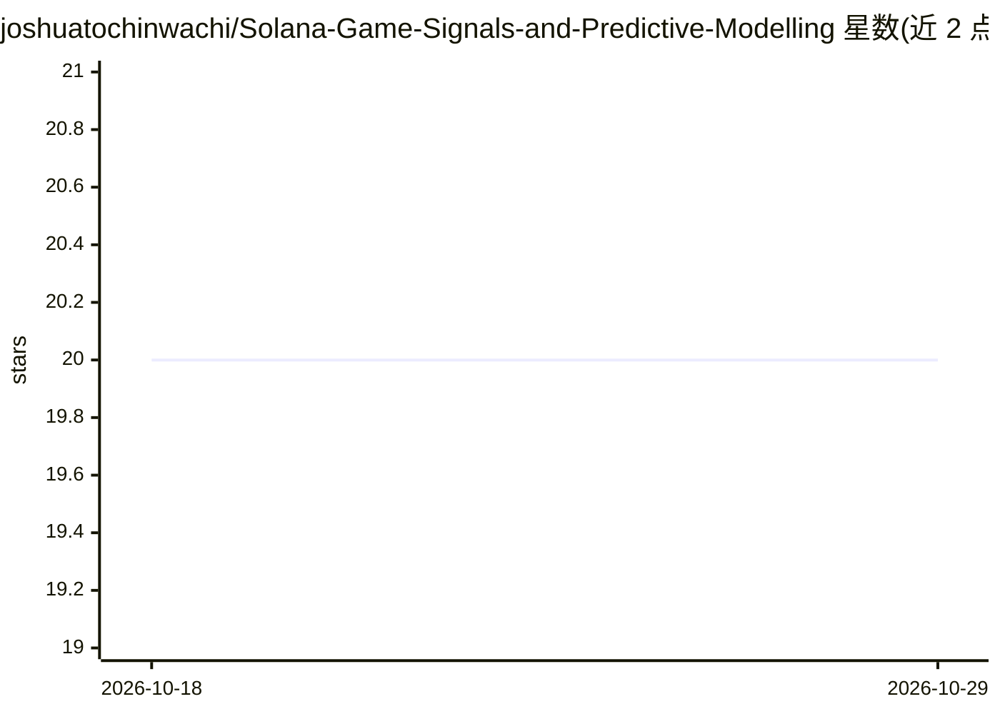

# joshuatochinwachi/Solana-Game-Signals-and-Predictive-Modelling

⭐ 20 · TypeScript · NOASSERTION · 推送 2026-02-18 · [GitHub](https://github.com/joshuatochinwachi/Solana-Game-Signals-and-Predictive-Modelling) · [官网](https://solana-games.app) · 个人维护

**Solana 游戏链上流失预测平台：提前 14 天预测玩家流失**

面向 Solana 游戏开发者与生态参与者的分析平台：通过 11 条 Dune SQL 查询聚合 12 款游戏 6000 万+ 链上交易，为每个用户-游戏对提取 10 个行为特征，用 5 种算法（逻辑回归/随机森林/GBDT/XGBoost/LightGBM）预测流失风险，缓存过期时自动重训并按 ROC-AUC 选出冠军模型，支持冠军/集成两种预测方式与动态百分位风险分级。后端 FastAPI 提供 21 个端点，前端 React 仪表盘含热力图、跨游戏网络图等可视化。运行需 Dune API key，部署在 Railway/Vercel。

## 筛选速览

| 维度 | 判定 | 备注 |
|---|---|---|
| AI 角色 | `ai-native` | 本体是模型或模型工具 |
| 许可风险 | `none` | NOASSERTION |
| 部署形态 | `None` |  |
| 模型依赖 | — | README 未给出锁定关系 |
| 硬件要求 | — | 无带数字的原话,不猜 |
| 安装摩擦 | `low` | 无编译、无系统依赖或容器化 |
| 成熟度 | — | 结构信号不足 |

## 能力要点

- 12 款游戏 60M+ 链上交易聚合与 11 项行为指标分析
- 5 种 ML 算法自动重训、按 ROC-AUC 自动选择冠军模型
- 提前 14 天流失预测，冠军/集成两种方式与动态百分位风险分级
- FastAPI 提供 11 个分析端点 + 5 个预测端点，React 仪表盘可视化

## 适用场景

- 游戏开发者提前识别高流失风险玩家并干预留存
- 跨游戏分析 Solana 生态玩家行为与留存队列
- 通过 REST API 获取各游戏每日活跃与流失数据

## 场景标签

`数据分析` · 领域:效率与自动化

## 证据(README 行号)

> L22: - **Predicts player churn 14 days in advance** using advanced ML (typically >85% ROC-AUC accuracy)
> L77: ### 🤖 Self-Training ML System
> L120: |**Backend**|Python 3.11, FastAPI, pandas, scikit-learn, XGBoost, LightGBM, joblib|Async API, robust ML, efficient

## 星数曲线

2026-10-18 20 → 2026-10-29 20（+0）

---
*卡片 v1 · prompt 1.4 · 生成 2026-10-28 · 置信度 high · 依据 README sha `361de0f356cf` · [字段定义](../../DATASET.md)*
