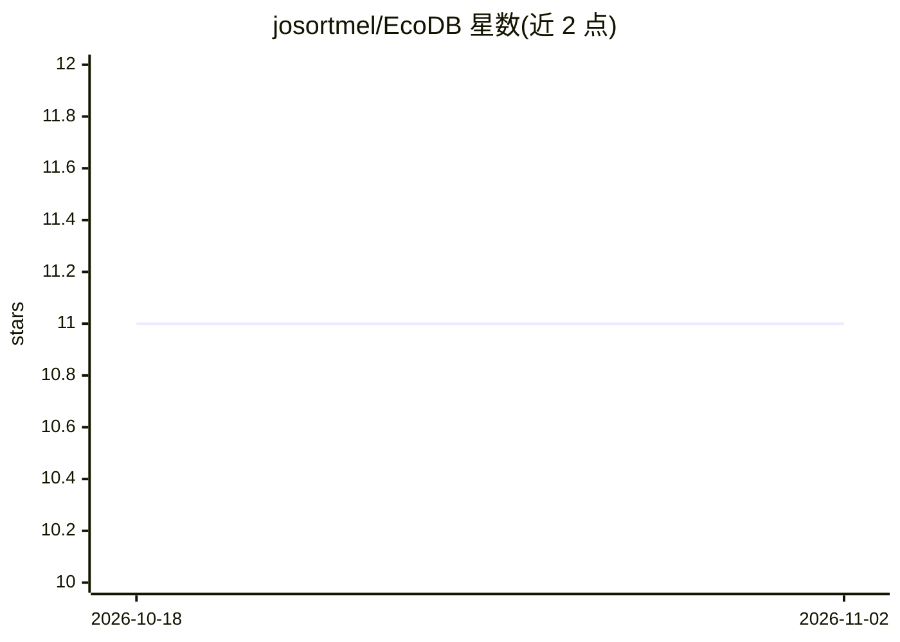

# josortmel/EcoDB

⭐ 11 · HTML · NOASSERTION · 推送 2026-10-29 · [GitHub](https://github.com/josortmel/EcoDB) · 个人维护

**多 agent 团队的共享 AI 记忆基础设施（GAMR 检索+知识图谱）**

面向多 agent 团队的共享记忆系统：多个 agent 在带工作区隔离与角色权限的环境中存储、检索、关联知识。核心是 10 阶段 GAMR 检索流水线（查询分类、向量+BM25 混合检索、图扩展、新鲜度、矛盾检测、复合打分、可选重排），用 Apache AGE 在 PostgreSQL 内建知识图谱，GLiNER 做实体抽取。支持文本/图像/文档多模态（Jina v4 嵌入），提供 40 个 MCP 工具、Electron 桌面治理面板，以及定期反思记忆的后台 metacognition 任务。以 Docker/FastAPI 后端形式部署，附 Windows 桌面安装包（未签名）。

## 筛选速览

| 维度 | 判定 | 备注 |
|---|---|---|
| AI 角色 | `ai-ecosystem` | LLM/agent 周边工具 |
| 许可风险 | `none` | NOASSERTION |
| 部署形态 | `self-host` | docker 或自建部署 |
| 模型依赖 | — | README 未给出锁定关系 |
| 硬件要求 | — | 无带数字的原话,不猜 |
| 安装摩擦 | `low` | 无编译、无系统依赖或容器化 |
| 成熟度 | — | 结构信号不足 |

## 能力要点

- 10 阶段 GAMR 检索流水线：混合检索+图扩展+新鲜度+矛盾检测
- Apache AGE 知识图谱（约 100 个谓词），GLiNER 自动实体抽取+人工字典审核
- 文本/图像/文档跨模态统一检索（Jina v4 同一向量空间）
- 40 个 MCP 工具，兼容 Claude Code/Cursor/Windsurf 等 MCP 客户端

## 适用场景

- 让团队里多个 agent 共享并治理跨项目记忆
- 对 PDF/DOCX 等文档做解析入库与图谱关联检索
- 通过桌面面板治理工作区、审核矛盾记忆与实体合并

## 场景标签

`多智能体` `Agent 记忆` `知识图谱` · 领域:Agent 开发

## 证据(README 行号)

> L13: Personal AI memory tools serve one agent, one session. EcoDB extends this to teams: a shared memory system where **
> L104: EcoDB's **GAMR engine** (Graph-Augmented Multimodal Retrieval) is a **10-stage scoring pipeline**:

## 星数曲线

2026-10-18 11 → 2026-11-02 11（+0）

---
*卡片 v1 · prompt 1.4 · 生成 2026-11-02 · 置信度 high · 依据 README sha `cc1f8384d4f5` · [字段定义](../../DATASET.md)*
