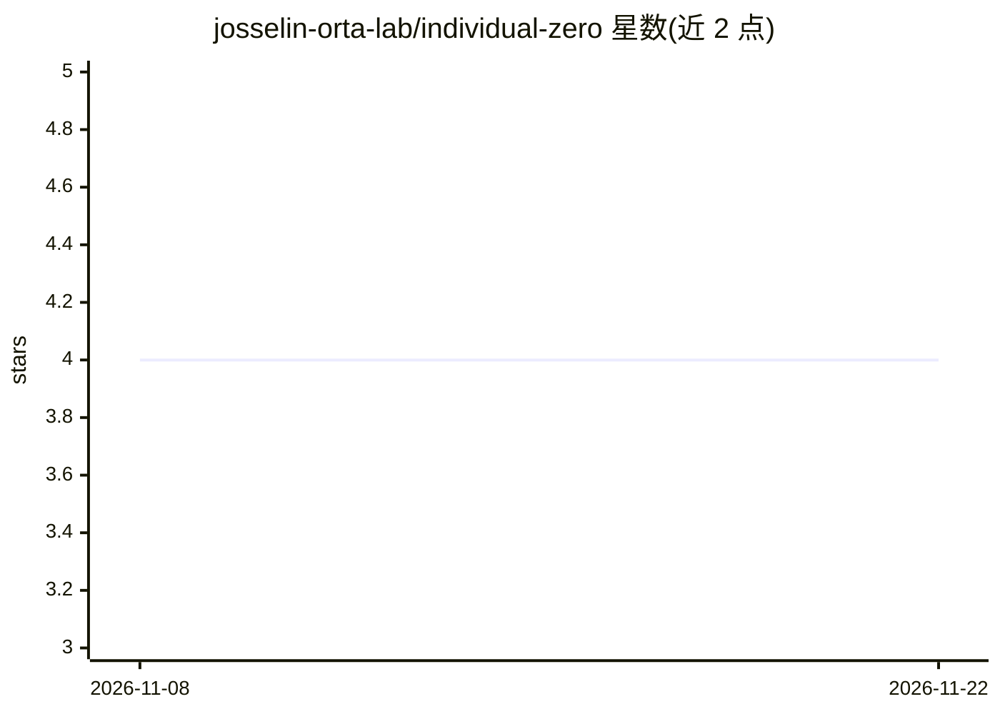

# josselin-orta-lab/individual-zero

⭐ 4 · Python · Apache-2.0 · 推送 2026-11-21 · [GitHub](https://github.com/josselin-orta-lab/individual-zero) · [官网](https://zenodo.org/records/23543637) · 个人维护

**具身 AI 与认知架构的开源研究计划：可检验的人工个体机制**

Individual Zero 是一个开源研究计划，探讨在统一人工系统中，感知、内部调节、情绪、记忆、学习、决策与自我建模等机制的交互能否产生连贯自适应行为。项目以「低抽象」为方法论，要求内部状态、决策、成本与后果可追溯，假设被翻译为可证伪、可复现的实验，负面结果亦纳入记录。仓库包含 I0–I3 多代架构（历史存档、活跃引擎、开发参考），并发布三篇 Zenodo 论文；代码 Apache 2.0，文档 CC BY 4.0。项目明确声明不主张 AGI 或人工意识。

## 筛选速览

| 维度 | 判定 | 备注 |
|---|---|---|
| AI 角色 | `ai-knowledge` | 知识聚合/清单类 |
| 许可风险 | `permissive` | Apache-2.0 |
| 部署形态 | `None` |  |
| 模型依赖 | — | README 未给出锁定关系 |
| 硬件要求 | — | 无带数字的原话,不猜 |
| 安装摩擦 | `low` | 无编译、无系统依赖或容器化 |
| 成熟度 | `idea` | |

## 能力要点

- 低抽象认知引擎：内部状态、决策、成本与后果可追溯
- 假设—实验—证据记录的可证伪研究流程，负面结果纳入记录
- 包含 I0–I3 多代架构与引擎注册表、ADR 决策记录
- 发布三篇 Zenodo DOI 论文并提供 CITATION.cff 引用元数据

## 适用场景

- 研究认知架构中感知、记忆与调节机制的交互假设
- 复现或挑战项目发布的具身学习实验
- 以可检查机制为基础提出替代假设并贡献代码

## 场景标签

 · 领域:认知科学/具身 AI 开放研究

## 证据(README 行号)

> L9: Individual Zero is an open-source research initiative exploring how coherent, adaptive behavior might emerge from ex
> L39: These are **research directions, not claims of achieved capabilities**.
> L45: Individual Zero is designed as an observable, falsifiable, and reproducible research effort.

## 星数曲线

2026-11-08 4 → 2026-11-22 4（+0）

---
*卡片 v1 · prompt 1.4 · 生成 2026-11-21 · 置信度 mid · 依据 README sha `b524f427bfaf` · [字段定义](../../DATASET.md)*
