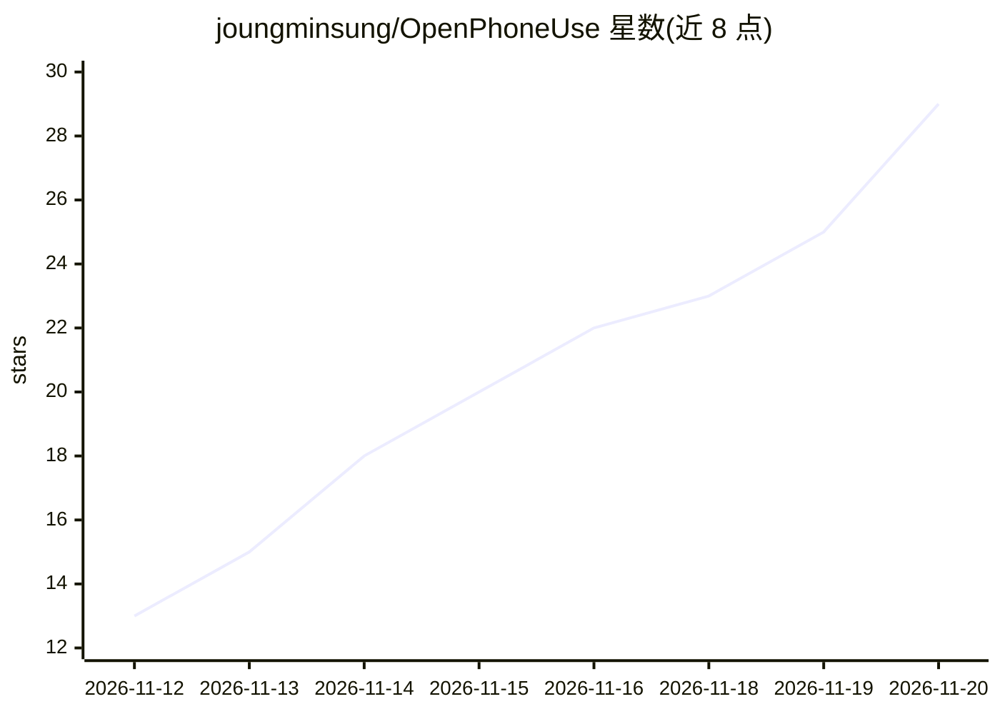

# joungminsung/OpenPhoneUse

⭐ 29 · Kotlin · MIT · 推送 2026-11-19 · [GitHub](https://github.com/joungminsung/OpenPhoneUse) · [官网](https://joungminsung.github.io/OpenPhoneUse/) · 个人维护

**让 AI 代理代你操作安卓手机的开源应用**

一个 Android 应用，通过无障碍服务读取屏幕树与截图，由模型下发 tap/type/scroll/open_app 等工具调用，代用户完成设置、闹钟、地图、网页、游戏等任务，全程在手机上运行，无需 PC、root、ADB 或 Shizuku。支持 ChatGPT 计划登录或各家 API key。内置风险分级与确认卡片机制：支付、安全变更、批量删除与发送前必须确认，且从不代输密码；令牌经 Android Keystore 加密。APK 约 70 MB，要求 Android 11 及以上。

## 筛选速览

| 维度 | 判定 | 备注 |
|---|---|---|
| AI 角色 | `ai-native` | 本体是模型或模型工具 |
| 许可风险 | `permissive` | MIT |
| 部署形态 | `None` |  |
| 模型依赖 | local-ok | 支持本地模型 |
| 硬件要求 | — | 无带数字的原话,不猜 |
| 安装摩擦 | `medium` | 含编译或系统依赖之一 |
| 成熟度 | — | 结构信号不足 |

## 能力要点

- 屏幕读取双通道：AccessibilityService 元素树 + Set-of-Mark 标注截图
- 风险确认机制：每次操作带模型自判风险标签，RiskGuard 关键词兜底，密码交给用户输入
- 支持 ChatGPT 计划、OpenAI/Claude/Grok/Gemini API key 及任意 OpenAI 兼容服务
- 纯 Kotlin 自研代理循环，不依赖 LangChain 等框架

## 适用场景

- 用一句话让手机完成夜间模式、勿扰、闹钟等批量设置
- 在既有应用内跨应用完成任务链（查日落时间并设闹钟）
- 在浏览器和地图中做比价、路线与行程规划
- 给长辈设置大字体大显示并代为操作常用应用

## 场景标签

`GUI 自动化` `AI 助手` · 领域:效率与自动化

## 证据(README 行号)

> L7: **OpenPhoneUse is an open-source Android app that lets an AI agent operate your phone like a person: it reads the sc
> L29: Ask in plain language, for example *"Get my phone ready for bed: turn on dark mode, set an alarm for 6:30 AM, and t
> L92: 3. **Check, then act.** Before every action the live screen is read again and the target is found there; if the scr

## 星数曲线

2026-11-12 13 → 2026-11-20 29（+16）

---
*卡片 v1 · prompt 1.4 · 生成 2026-11-18 · 置信度 high · 依据 README sha `f7623a5ea3de` · [字段定义](../../DATASET.md)*
