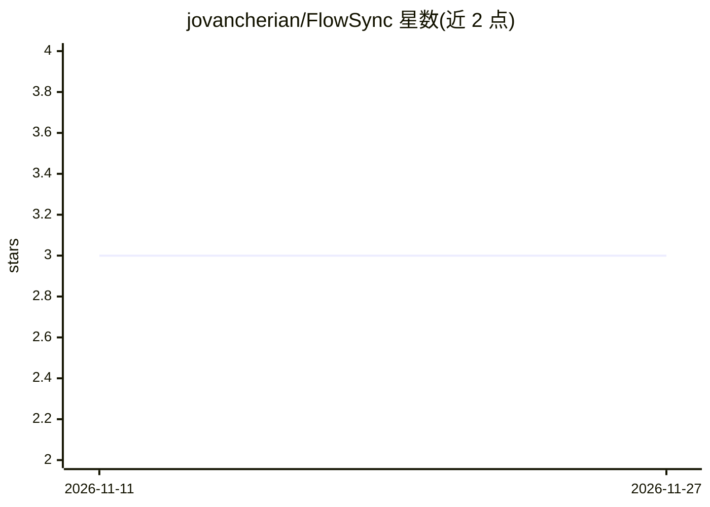

# jovancherian/FlowSync

⭐ 3 · MIT · 推送 2026-11-11 · [GitHub](https://github.com/jovancherian/FlowSync) · 个人维护

**在 Claude 与 ChatGPT 之间实时同步工具状态的开发者插件**

FlowSync 以插件形式提供不同 AI 服务（Claude 与 ChatGPT）之间工具状态的实时同步，使用户可切换到另一 AI 服务并从中断处继续。README 标明项目当前处于 MVP 开发阶段，主题标签显示其以 Claude plugin/skill 与 MCP server 形式分发。可见内容未包含安装步骤、架构细节或使用限制的说明。

## 筛选速览

| 维度 | 判定 | 备注 |
|---|---|---|
| AI 角色 | `ai-ecosystem` | LLM/agent 周边工具 |
| 许可风险 | `permissive` | MIT |
| 部署形态 | `None` |  |
| 模型依赖 | — | README 未给出锁定关系 |
| 硬件要求 | — | 无带数字的原话,不猜 |
| 安装摩擦 | `low` | 无编译、无系统依赖或容器化 |
| 成熟度 | `idea` | |

## 能力要点

- 提供 Claude 与 ChatGPT 之间工具的实时同步
- 以 Claude plugin/skill 与 MCP server 形式提供
- 支持跨 AI 服务从中断处继续会话

## 适用场景

- 在同一工作流中从 Claude 切换到 ChatGPT 并延续上下文
- 通过 MCP 在 agent 工具链中接入同步能力

## 场景标签

 · 领域:LLM 基础设施/工具集成

## 证据(README 行号)

> L5: FlowSync is an Agentic plugin, that provides real-time sync between the different AI providers’ tools (Claude &amp; 
> L7: MVP is under development.

## 星数曲线

2026-11-11 3 → 2026-11-27 3（+0）

---
*卡片 v1 · prompt 1.4 · 生成 2026-11-21 · 置信度 low · 依据 README sha `07ed0ee942db` · [字段定义](../../DATASET.md)*
