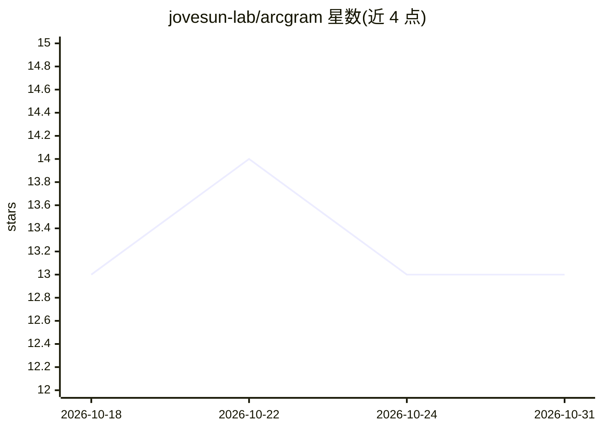

# jovesun-lab/arcgram

⭐ 13 · HTML · Apache-2.0 · 推送 2026-10-16 · [GitHub](https://github.com/jovesun-lab/arcgram) · [官网](https://arcgram.io) · 个人维护 · 中文 README

**让 AI agent 把推理计划画成可审校的节点图（单 HTML 文件）**

面向人类–AI 协作的交互式图表引擎：AI agent 读取 SKILL.md 技能文件，将自身计划写入 template-v2.html 顶部数据块，生成约 290 KB、无依赖、可在任意浏览器打开的单 HTML 流程图（平移/缩放/悬停/过滤），内置 Checkpoint/Reconcile/Validate 三项自检标记问题节点，用户按节点名用自然语言指出错误让 agent 修正。支持 Claude/GPT/Gemini/DeepSeek/Kimi/GLM，可运行于 Claude Code、Cursor、Cline、Aider 及中等规模本地模型，也可通过插件市场安装。

## 筛选速览

| 维度 | 判定 | 备注 |
|---|---|---|
| AI 角色 | `ai-ecosystem` | LLM/agent 周边工具 |
| 许可风险 | `permissive` | Apache-2.0 |
| 部署形态 | `None` |  |
| 模型依赖 | — | README 未给出锁定关系 |
| 硬件要求 | — | 无带数字的原话,不猜 |
| 安装摩擦 | `low` | 无编译、无系统依赖或容器化 |
| 成熟度 | — | 结构信号不足 |

## 能力要点

- agent 写数据块、单文件 HTML 输出（约 290 KB、无构建/CDN 依赖）
- 三项自检（Checkpoint / Reconcile / Validate）标记需修正节点
- 节点固定位置与命名，支持按名指错与 Audit 红旗标记
- v2 支持左右布局、决策节点、嵌套图、分组过滤

## 适用场景

- 在执行前检查 AI agent 的计划或工作流中的断链与循环依赖
- 让 agent 自动绘图并自检，我按节点名反馈修正
- 将分析/工作流以单 HTML 文件分享给他人查看

## 场景标签

 · 领域:AI 协作工具/图表引擎

## 证据(README 行号)

> L20: One skill file. Runs on Claude, GPT, and Gemini — and on DeepSeek, Kimi (Moonshot), and Zhipu GLM — in tools like C
> L38: That gives your agent the authoring skill plus three self-checks (Checkpoint / Reconcile / Validate). Then just ask

## 星数曲线

2026-10-18 13 → 2026-10-31 13（+0）

---
*卡片 v1 · prompt 1.4 · 生成 2026-10-31 · 置信度 high · 依据 README sha `0a031abadb95` · [字段定义](../../DATASET.md)*
