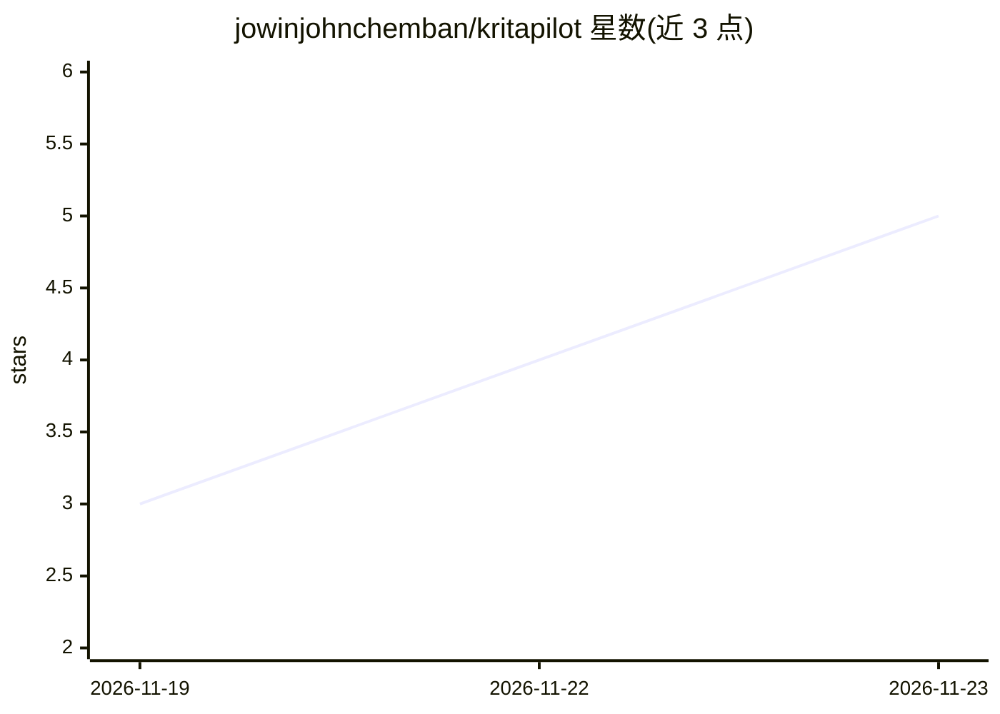

# jowinjohnchemban/kritapilot

⭐ 5 · Python · MIT · 推送 2026-11-21 · [GitHub](https://github.com/jowinjohnchemban/kritapilot) · [官网](https://pypi.org/project/kritapilot/) · 个人维护

**让 AI 代理与内置聊天在 Krita 中作画、修图、生成动画视频的 MCP 服务器**

以 MCP 服务器形式供 Claude、ChatGPT、Gemini、Cursor、VS Code Copilot 等客户端连接运行中的 Krita，同时在 Krita 内提供 AI Chat 面板，可登录 40+ 服务商或使用免登录免费模型，额度耗尽时 Auto 机制切换下一家。提供 98 个工具覆盖画笔、图层、选区、滤镜、动画与视频，支持 ComfyUI、AUTOMATIC1111、OpenAI、Gemini 等图像模型生成与指令式编辑，所有结果落在可撤销的新图层。仅回环通信加令牌鉴权，限定单一工作区文件夹。

## 筛选速览

| 维度 | 判定 | 备注 |
|---|---|---|
| AI 角色 | `ai-native` | 本体是模型或模型工具 |
| 许可风险 | `permissive` | MIT |
| 部署形态 | `library` | 以包/库形式分发 |
| 模型依赖 | local-ok | 支持本地模型 |
| 硬件要求 | — | 无带数字的原话,不猜 |
| 安装摩擦 | `medium` | 含编译或系统依赖之一 |
| 成熟度 | — | 结构信号不足 |

## 能力要点

- 98 个工具覆盖 Krita 画笔引擎、图层、选区、滤镜、动画与视频
- AI Chat 支持 40+ 服务商，内置免账号免费模型与自动切换
- 兼容 ComfyUI、AUTOMATIC1111、OpenAI、Gemini、Replicate、fal.ai 等图像/视频模型
- 安全机制：仅回环+令牌、单一工作区、无代码执行、AI 步骤可撤销

## 适用场景

- 让 AI 代理在 Krita 里按描述作画或修图，结果留在可编辑图层
- 在 Krita 内置聊天面板用免费模型直接生成图像
- 把草图接 ControlNet 出图、局部重绘、扩图与去背景
- 生成视频并导入 Krita 作为可编辑动画逐帧加工

## 场景标签

`图像生成` `图像视频处理` `视频生成` · 领域:内容生成

## 证据(README 行号)

> L13: KritaPilot is a **Krita MCP server** for any MCP client - Claude, ChatGPT, Gemini, Cursor, VS Code Copilot,
> L14: Codex and others - and an **AI Chat inside Krita** that works with 40+ AI providers, including free ones.
> L37: - **Real tools, not just a prompt box.** 98 tools cover Krita's brush engine, layers, selections, filters,

## 星数曲线

2026-11-19 3 → 2026-11-23 5（+2）

---
*卡片 v1 · prompt 1.4 · 生成 2026-11-22 · 置信度 high · 依据 README sha `eb983f159914` · [字段定义](../../DATASET.md)*
