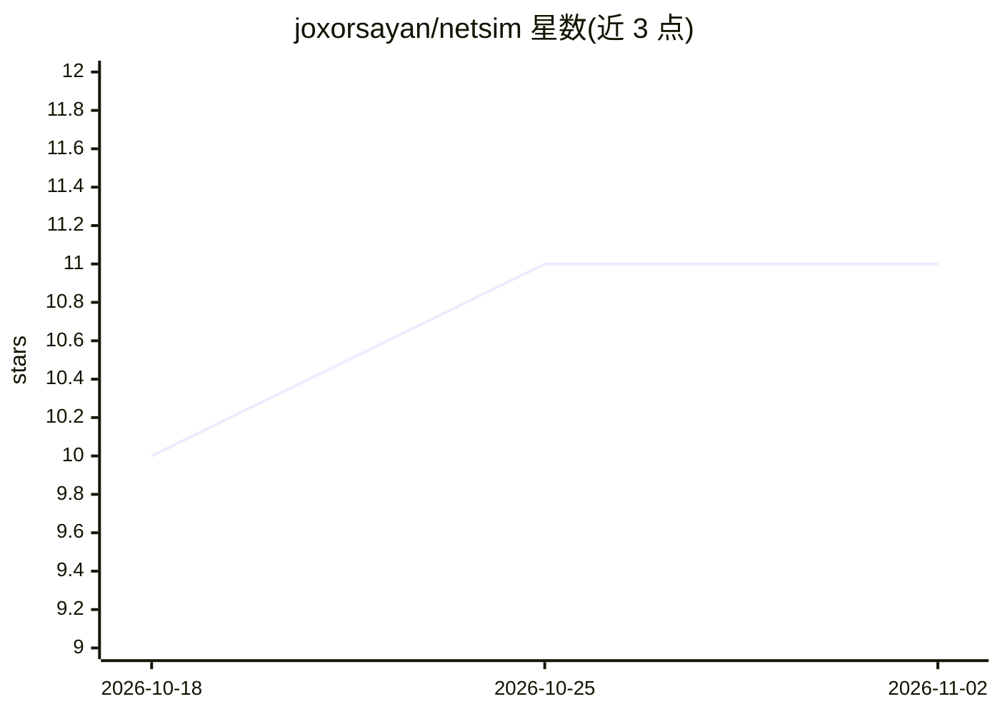

# joxorsayan/netsim

⭐ 11 · Python · MIT · 推送 2026-06-21 · [GitHub](https://github.com/joxorsayan/netsim) · [官网](https://netsim-lab.osc-fr1.scalingo.io) · 个人维护

**浏览器内 CCNA 网络模拟器，带 Cisco 风格 CLI 与设备端 AI 导师**

开源、零安装的网页版网络模拟器：纯 Python 离散事件引擎建模交换/路由/ARP/ICMP/DHCP/STP 等 CCNA 级协议，提供 Cisco IOS 风格 CLI、拓扑编辑器、可导出 Wireshark .pcap 的抓包功能、labs-as-code 自动评分，以及基于 Python SDK+CLI 的 NetDevOps 自动化（Jinja2 模板、推送、漂移检测、CI）。内置 AI 导师扫描实时拓扑解释故障原因：离线规则引擎保底，可选在浏览器内运行 Qwen2.5 LoRA 微调模型（transformers.js/WebGPU，无需 API key），或改用 Cloudflare Workers AI。FastAPI 后端，单 worker 部署，拓扑状态存于进程内。

## 筛选速览

| 维度 | 判定 | 备注 |
|---|---|---|
| AI 角色 | `ai-enhanced` | 去掉 AI 部分产品仍成立 |
| 许可风险 | `permissive` | MIT |
| 部署形态 | `library` | 以包/库形式分发 |
| 模型依赖 | — | README 未给出锁定关系 |
| 硬件要求 | — | 无带数字的原话,不猜 |
| 安装摩擦 | `low` | 无编译、无系统依赖或容器化 |
| 成熟度 | — | 结构信号不足 |

## 能力要点

- 纯 Python 模拟引擎覆盖 VLAN/STP/OSPF/BGP/EIGRP/RIP/DHCP/NAT/IPv6 双栈
- 每跳帧记录可回放并导出 Wireshark .pcap
- 设备端 AI 导师：Qwen2.5 LoRA 微调 + ONNX 4-bit + transformers.js/WebGPU，规则引擎保底
- labs-as-code 自动评分（0-100）与 NetDevOps SDK/CI 管线

## 适用场景

- 在浏览器中练习 CCNA 级路由交换实验，无需安装或账号
- 向 AI 导师询问实验不通的原因并获得修复建议
- 用声明式 YAML 部署并自动验证网络配置，用于教学考核

## 场景标签

 · 领域:网络工程/教育

## 证据(README 行号)

> L21: **NetSim** is an open-source, browser-based **network simulator** (a lightweight, web-native alternative to Cisco P
> L46: |🤖 **AI tutor**|Ask *"why can't PC1 ping PC2?"* — it scans your live topology (interfaces down, subnet/area mismatc

## 星数曲线

2026-10-18 10 → 2026-11-02 11（+1）

---
*卡片 v1 · prompt 1.4 · 生成 2026-11-02 · 置信度 mid · 依据 README sha `2599b0871211` · [字段定义](../../DATASET.md)*
