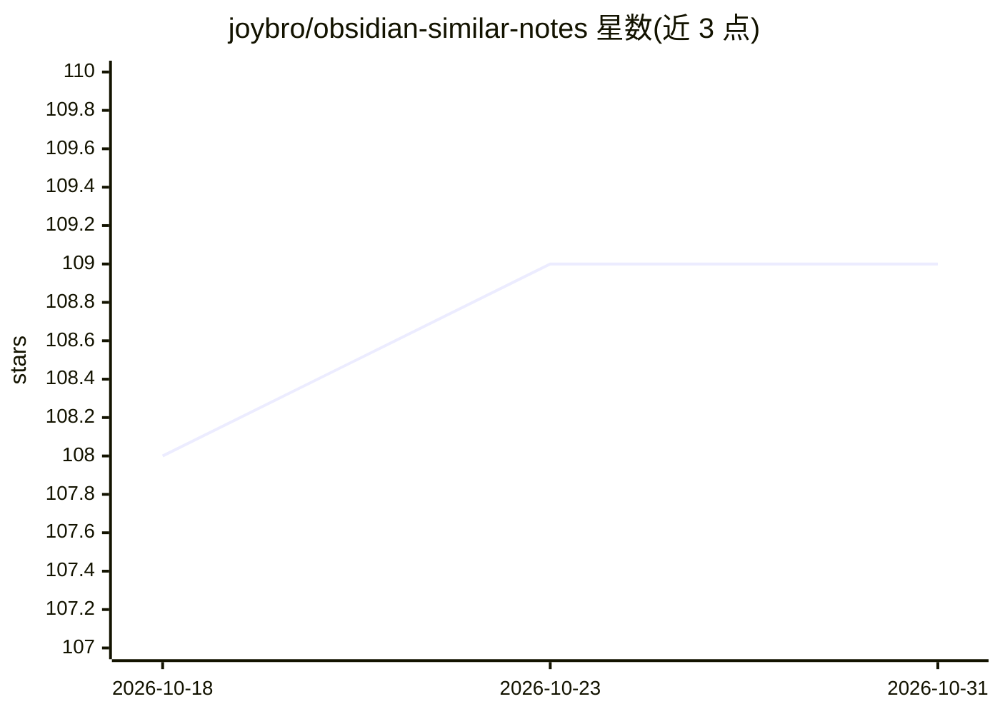

# joybro/obsidian-similar-notes

⭐ 109 · TypeScript · MIT · 推送 2026-09-05 · [GitHub](https://github.com/joybro/obsidian-similar-notes) · 个人维护

**Obsidian 笔记语义相似查找与语义搜索插件**

Obsidian 插件，在笔记下方实时展示语义相似笔记，并提供按语义（而非关键词）搜索整个 vault 的功能。模型层支持多种来源：内置 Sentence Transformer（ONNX 权重，Transformers.js 本地运行，含 WebGPU 加速与 CPU 回退）、OpenAI 及任何 OpenAI 兼容 API（含 OpenRouter 接入）、Ollama 嵌入模型（仅桌面端）。索引数据存于设备本地 IndexedDB，各设备独立维护、不随 vault 同步。另提供将相似笔记结果导出 JSON 供外部编码 agent 复用的命令。

## 筛选速览

| 维度 | 判定 | 备注 |
|---|---|---|
| AI 角色 | `ai-enhanced` | 去掉 AI 部分产品仍成立 |
| 许可风险 | `permissive` | MIT |
| 部署形态 | `None` |  |
| 模型依赖 | local-ok | 支持本地模型 |
| 硬件要求 | — | 无带数字的原话,不猜 |
| 安装摩擦 | `low` | 无编译、无系统依赖或容器化 |
| 成熟度 | — | 结构信号不足 |

## 能力要点

- 内置 ONNX Sentence Transformer 模型，本地运行无需 API key
- 支持 OpenAI/兼容 API、OpenRouter、Ollama（仅桌面）多种嵌入来源
- Transformers.js + WebGPU 加速，Orama 内置向量数据库
- 相似笔记结果可导出 JSON 供外部 agent 复用

## 适用场景

- 写作时自动发现 vault 中语义相关的笔记
- 按含义而非关键词搜索自己的笔记库
- 让本地或云端嵌入模型在私有笔记中做语义检索

## 场景标签

`语义搜索` · 领域:知识与检索

## 证据(README 行号)

> L5: Find semantically similar notes using AI. Choose local models for privacy or cloud APIs for flexibility.
> L9: As you write, similar notes appear at the bottom of your current note.
> L15: Press `Cmd+Shift+O` (or `Ctrl+Shift+O`) to search your vault by meaning, not just keywords.

## 星数曲线

2026-10-18 108 → 2026-10-31 109（+1）

---
*卡片 v1 · prompt 1.4 · 生成 2026-10-23 · 置信度 high · 依据 README sha `5702ba7957da` · [字段定义](../../DATASET.md)*
