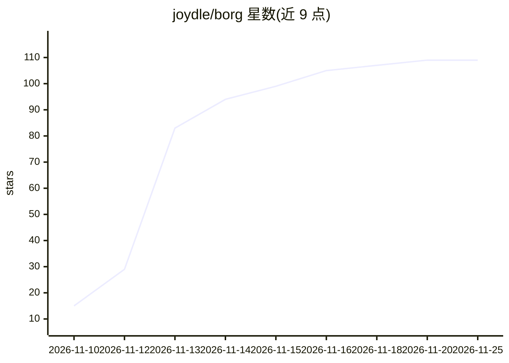

# joydle/borg

⭐ 109 · Rust · Apache-2.0 · 推送 2026-11-17 · [GitHub](https://github.com/joydle/borg) · [官网](https://joydle.github.io/borg/) · 个人维护

**面向 Rust 开发者的监督式 agent 运行时，编排可恢复的 LLM 流水线**

以 Rust 库形式提供的 LLM agent 运行时：将 LLM 调用组合为 Sequential/Parallel/Branch/LoopUntil 等流水线，提供取消、panic 隔离、退避重启、熔断、预算控制与检查点恢复。不内置 provider 客户端，用户需自行实现 AgentLlmClient 接入所用 API；示例可用 FakeLlmClient 无 API key 运行。支持 MCP 服务器转为工具、长生命周期会话、人工审批暂停恢复与 tracing 观测。通过 GitHub git 依赖安装（crates.io 上同名 crate 无关），要求 Rust 1.88+ 与 Tokio，MIT/Apache-2.0 双许可。

## 筛选速览

| 维度 | 判定 | 备注 |
|---|---|---|
| AI 角色 | `ai-ecosystem` | LLM/agent 周边工具 |
| 许可风险 | `permissive` | Apache-2.0 |
| 部署形态 | `library` | 以包/库形式分发 |
| 模型依赖 | — | README 未给出锁定关系 |
| 硬件要求 | — | 无带数字的原话,不猜 |
| 安装摩擦 | `low` | 无编译、无系统依赖或容器化 |
| 成熟度 | — | 结构信号不足 |

## 能力要点

- 组合原语（Single/Parallel/Branch/LoopUntil 等）与 pipeline! 宏
- 监督机制：panic 隔离、退避重启、熔断、跨模型 fallback 梯队
- 预算准入与检查点恢复，崩溃后跳过已完成工作
- stdio MCP 服务器可作为工具，含人工审批暂停/恢复

## 适用场景

- 在 Rust 服务中构建可取消、可恢复的多步 LLM 流水线
- 为 agent 子进程/文件操作加预算与熔断控制
- 长生命周期流式会话的中断续跑

## 场景标签

`Agent 框架` · 领域:Agent 开发

## 证据(README 行号)

> L11: **borg is a supervised agent runtime for Rust.** Compose LLM calls into
> L33: borg ships no provider client: implement `AgentLlmClient` once for the

## 星数曲线

2026-11-10 15 → 2026-11-25 109（+94）

---
*卡片 v1 · prompt 1.4 · 生成 2026-11-18 · 置信度 high · 依据 README sha `295cb24715fe` · [字段定义](../../DATASET.md)*
