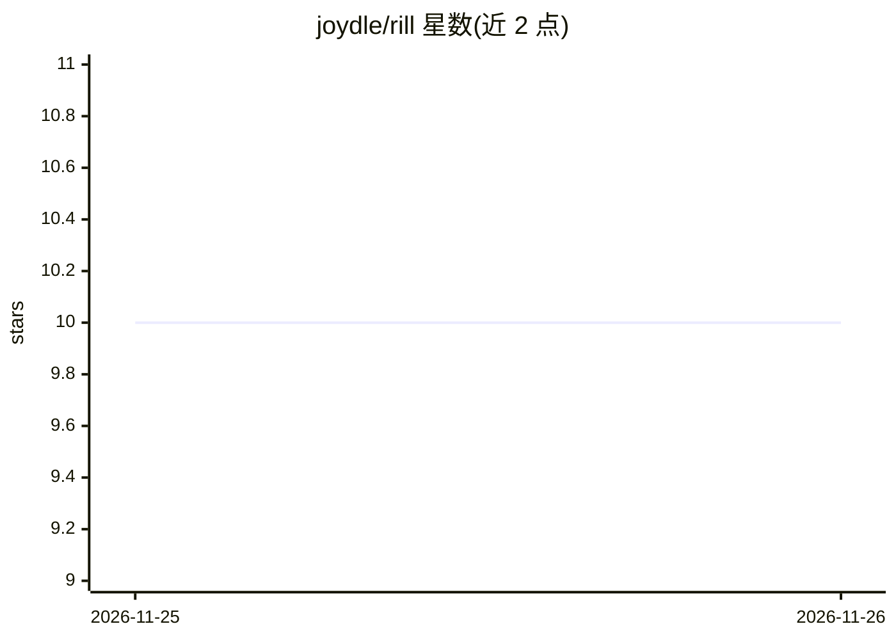

# joydle/rill

⭐ 10 · Swift · MIT · 推送 2026-09-09 · [GitHub](https://github.com/joydle/rill) · 个人维护

**SwiftUI 流式 Markdown 增量解析与渲染库**

面向 SwiftUI 应用的流式 Markdown 渲染包：针对逐 token 到达的文本（如 LLM 流式回复），每次增量只重新解析未闭合的脏尾部，已提交的闭合块按内容派生的 NodeID 冻结复用，单次增量解析成本不随文档长度增长。提供原生 TeX 数学排版（纯 Swift + CoreText，无字体图集）、CommonMark 子集加 GFM 扩展（表格、任务列表、脚注、GitHub alerts）、主题定制、解析/渲染遥测，以及无 UI 的 RillCore 解析器。要求 Xcode 16+、iOS 18+/macOS 15+，零外部依赖，MIT 许可。

## 筛选速览

| 维度 | 判定 | 备注 |
|---|---|---|
| AI 角色 | `ai-enhanced` | 去掉 AI 部分产品仍成立 |
| 许可风险 | `permissive` | MIT |
| 部署形态 | `None` |  |
| 模型依赖 | — | README 未给出锁定关系 |
| 硬件要求 | — | 无带数字的原话,不猜 |
| 安装摩擦 | `low` | 无编译、无系统依赖或容器化 |
| 成熟度 | — | 结构信号不足 |

## 能力要点

- 增量解析仅重处理脏尾部，单次增量成本 O(tail)
- 原生 TeX 数学排版引擎，无字体图集与图片栅格化
- 流式等价性：任意分块方式最终 Document 与一次性解析一致
- 分层架构：RillCore/RillMath/RillAnalytics 不导入 SwiftUI/UIKit

## 适用场景

- 在 iOS/macOS 聊天应用中流式渲染 LLM 回复
- 渲染含 LaTeX 公式与表格的 Markdown 内容
- 只用 RillCore 解析器自行构建视图层

## 场景标签

 · 领域:开发者工具/客户端 UI 库

## 证据(README 行号)

> L5:  Incremental Markdown parsing and SwiftUI rendering for streamed text.
> L14: Rill renders Markdown that arrives incrementally, such as an LLM response streamed
> L123: - **Layered, UI-free core.** `RillCore`, `RillMath`, and `RillAnalytics` never import

## 星数曲线

2026-11-25 10 → 2026-11-26 10（+0）

---
*卡片 v1 · prompt 1.4 · 生成 2026-11-24 · 置信度 high · 依据 README sha `cf14668cd188` · [字段定义](../../DATASET.md)*
