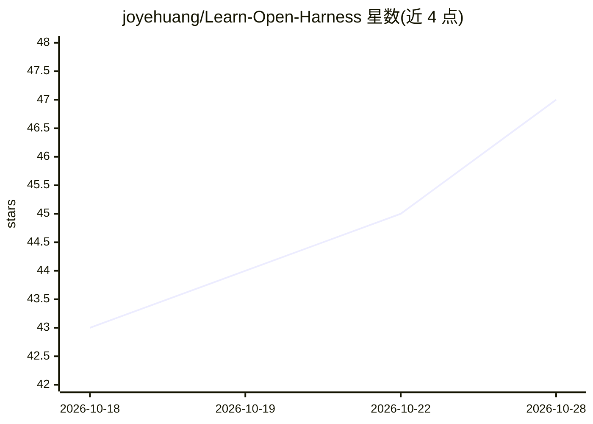

# joyehuang/Learn-Open-Harness

⭐ 47 · TypeScript · 推送 2026-04-07 · [GitHub](https://github.com/joyehuang/Learn-Open-Harness) · [官网](https://learn-open-harness.vercel.app/) · 个人维护 · 中文 README

**OpenHarness 的交互式教程：12 章讲解 AI Agent 架构**

面向零基础学习者的交互式网页教程，配套 HKUDS/OpenHarness 项目，分 12 章讲解 Claude Code 背后的 Agent 架构：Agent Loop、工具系统、权限分级、Hook、记忆、MCP 与多智能体等。每章配动画演示、动手模拟器与即时反馈测验，自动跟踪学习进度，无需 AI 或编程基础。以 Next.js 16 + TypeScript 构建的网页应用形式提供，含中文版，git clone 后 npm 安装运行。

## 筛选速览

| 维度 | 判定 | 备注 |
|---|---|---|
| AI 角色 | `ai-knowledge` | 知识聚合/清单类 |
| 许可风险 | `none` | — |
| 部署形态 | `library` | 以包/库形式分发 |
| 模型依赖 | — | README 未给出锁定关系 |
| 硬件要求 | — | 无带数字的原话,不猜 |
| 安装摩擦 | `low` | 无编译、无系统依赖或容器化 |
| 成熟度 | — | 结构信号不足 |

## 能力要点

- 12 章课程覆盖从 Agent 基础到 Multi-Agent 协作
- 交互式元素：Agent Loop 动画、Tool Explorer、权限沙盒
- 每章嵌入即时反馈测验并自动跟踪进度
- 提供中文版，无需 AI 或编程基础

## 适用场景

- 在阅读 OpenHarness 源码前先理解其核心概念
- 零基础系统学习 AI Agent / Agent Harness 架构
- 通过动画与模拟器直观理解 Agent Loop 与权限机制

## 场景标签

`教程课程` · 领域:学习与行业

## 证据(README 行号)

> L5: Zero to Hero in 12 chapters. Learn the architecture behind Claude Code: Agent Loop, Tools, Memory, Permissions, Mult
> L21: So I built this the next day: **12 interactive chapters** that break down every core concept with real-world analog

## 星数曲线

2026-10-18 43 → 2026-10-28 47（+4）

---
*卡片 v1 · prompt 1.4 · 生成 2026-10-25 · 置信度 high · 依据 README sha `29dffc390f5f` · [字段定义](../../DATASET.md)*
