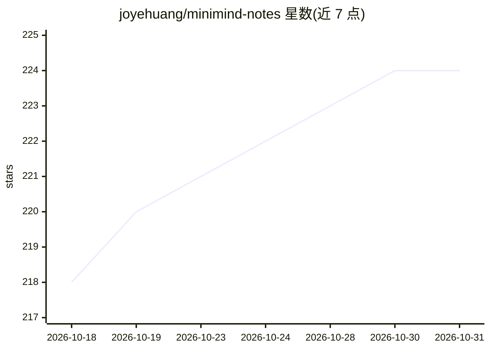

# joyehuang/minimind-notes

⭐ 224 · Python · Apache-2.0 · 推送 2026-06-04 · [GitHub](https://github.com/joyehuang/minimind-notes) · [官网](https://www.minimind.wiki/) · 个人维护 · 中文 README

**从零理解 LLM 训练原理的模块化教程与对比实验集**

基于 MiniMind 项目构建的模块化 LLM 训练教学仓库：将 Transformer、归一化、位置编码、Attention 等内容拆为 6 个独立模块，每个模块通过对比实验（如 NoNorm/Post-LN/Pre-LN 的收敛与 NaN 对比）回答'为什么这样设计'。实验基于 TinyShakespeare 或合成数据，CPU/MPS 可运行、单个实验 10 分钟内完成；完整训练需要 NVIDIA GPU。面向有 PyTorch 基础、准备 LLM 岗位面试或研究 LLM 原理的学生与开发者，部分模块文档仍在补充中。

## 筛选速览

| 维度 | 判定 | 备注 |
|---|---|---|
| AI 角色 | `ai-knowledge` | 知识聚合/清单类 |
| 许可风险 | `permissive` | Apache-2.0 |
| 部署形态 | `None` |  |
| 模型依赖 | — | README 未给出锁定关系 |
| 硬件要求 | — | 无带数字的原话,不猜 |
| 安装摩擦 | `low` | 无编译、无系统依赖或容器化 |
| 成熟度 | — | 结构信号不足 |

## 能力要点

- 6 个模块化教学单元，每模块围绕核心设计问题组织
- 对比实验设计：用实验数据回答'如果不这样做会怎样'
- 实验在 CPU/MPS 上可运行，单个实验 <10 分钟，总数据 <100MB
- 提供 30 分钟/6 小时/30+ 小时三档学习路径

## 适用场景

- 准备 LLM 岗位面试，系统掌握 Transformer 与训练原理
- 通过对比实验理解 Pre-LN、RoPE 等设计选择的原因
- 从零跟做并训练小型语言模型

## 场景标签

`教程课程` `模型训练` · 领域:学习与行业

## 证据(README 行号)

> L26: MiniMind 旨在通过实践帮助开发者深度理解大语言模型（LLM）的训练机制，使用极其简洁的代码和**对比实验**。它不仅告诉你"怎么做"，更通过实验数据向你展示"为什么这样做"。
> L32: 这是一个**模块化的 LLM 训练教程**，帮助你理解现代大语言模型（如 Llama、GPT）的训练原理。
> L136: ### 1. 对比实验设计

## 星数曲线

2026-10-18 218 → 2026-10-31 224（+6）

---
*卡片 v1 · prompt 1.4 · 生成 2026-10-22 · 置信度 high · 依据 README sha `20fd61861944` · [字段定义](../../DATASET.md)*
