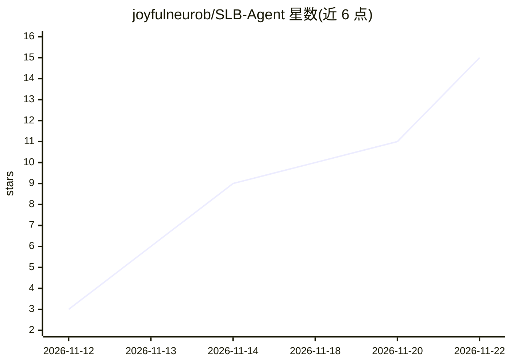

# joyfulneurob/SLB-Agent

⭐ 15 · MIT · 推送 2026-11-20 · [GitHub](https://github.com/joyfulneurob/SLB-Agent) · [官网](https://t.me/jiaoliuqunsbl) · 组织维护 · 中文 README

**桌面多模型 AI Agent 客户端，内置破限与红队插件**

基于 Electron 的桌面 Agent 客户端：通过 OpenAI 兼容 / Anthropic / Gemini 三协议接入 28+ 厂商 API Key 或 Ollama 本地模型；Agent 可浏览目录、读写文件、执行终端命令、联网搜索与抓取网页，支持 MCP 客户端（stdio / HTTP / SSE）、Markdown 技能包、四档权限模式与检查点回滚。内置 Armor Engine 破限插件（9 个 armor_* 工具、四档强度、11 模型族适配、拒绝对症与自动升档）及红队作业、逆向分析、网页爬虫插件。安装包免费下载，附试用期，期满需离线授权密钥解锁完整功能；声明仅供学习、研究与授权安全测试使用。

## 筛选速览

| 维度 | 判定 | 备注 |
|---|---|---|
| AI 角色 | `ai-ecosystem` | LLM/agent 周边工具 |
| 许可风险 | `permissive` | MIT |
| 部署形态 | `desktop` | 安装包/桌面程序 |
| 模型依赖 | local-ok | 支持本地模型 |
| 硬件要求 | — | 无带数字的原话,不猜 |
| 安装摩擦 | `low` | 无编译、无系统依赖或容器化 |
| 成熟度 | — | 结构信号不足 |

## 能力要点

- 三协议接入 28+ 厂商及 Ollama 本地模型，API Key 存系统钥匙串
- Agent 工具箱：读写文件、执行命令、联网搜索、抓取网页
- MCP 客户端，可导入 Claude Desktop / Cursor 的 mcpServers 配置
- Armor Engine：9 个 armor_* 工具，四档强度 × 11 模型族 × 3 场景

## 适用场景

- 用一个客户端接入多家厂商 API Key 并随时切换模型
- 让 Agent 挂载项目文件夹读代码、改文件、跑命令
- 授权渗透测试场景使用红队作业套件与技能包

## 场景标签

`模型网关` `网络安全` · 领域:Agent 开发

## 证据(README 行号)

> L7: **跑在你自己电脑上的桌面 AI Agent —— 任意厂商 API Key 接入，读代码、改文件、跑命令；内置 Armor Engine 破限内核，让顽固模型稳定交付完整可执行的内容。**
> L53: |**多模型接入**|OpenAI 兼容 / Anthropic / Gemini 三协议，预置 28+ 家厂商目录，覆盖 Claude、GPT、Gemini、Grok、Mistral、DeepSeek、通义、Kimi、GLM、豆
> L31: - ⚡ **不只是聊天** —— Agent 真正动手：浏览目录、读写文件、正则搜索、执行终端命令、联网搜索、抓取网页、管理待办

## 星数曲线

2026-11-12 3 → 2026-11-22 15（+12）

---
*卡片 v1 · prompt 1.4 · 生成 2026-11-19 · 置信度 high · 依据 README sha `8401e3b1c81b` · [字段定义](../../DATASET.md)*
