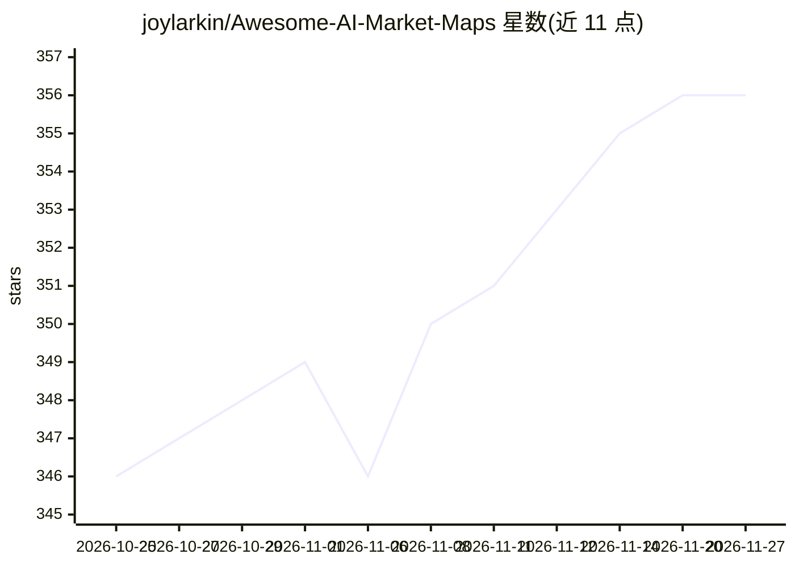

# joylarkin/Awesome-AI-Market-Maps

⭐ 356 · Python · MIT · 推送 2026-11-16 · [GitHub](https://github.com/joylarkin/Awesome-AI-Market-Maps) · 个人维护

**面向 AI 从业者的 500+ AI 市场图谱策展清单**

按季度组织的人工智能创业公司市场图谱（market map）聚合清单，收录 500 余份来自 VC、行业分析师与从业者的图谱、榜单与行业定位报告，覆盖 AI Agent、企业 AI、物理 AI、AI 安全、医疗 AI 等类别。数据收集流程包含 Claude、Exa Websets 与人工筛选；README 持续更新，CSV 双月更新，并提供 MCP server、Hugging Face 数据集、RSS 订阅与博客文章等访问方式，接受 Pull Request 提交新条目。

## 筛选速览

| 维度 | 判定 | 备注 |
|---|---|---|
| AI 角色 | `ai-knowledge` | 知识聚合/清单类 |
| 许可风险 | `permissive` | MIT |
| 部署形态 | `library` | 以包/库形式分发 |
| 模型依赖 | — | README 未给出锁定关系 |
| 硬件要求 | — | 无带数字的原话,不猜 |
| 安装摩擦 | `low` | 无编译、无系统依赖或容器化 |
| 成熟度 | — | 结构信号不足 |

## 能力要点

- 收录 500+ 份来自 VC、分析师与从业者的 AI 市场图谱
- 按季度组织以呈现行业话题演变
- 提供 CSV 检索、MCP server、Hugging Face 数据集与 RSS 订阅
- 接受 Pull Request 与邮件/社媒提交新图谱

## 适用场景

- 跟踪 VC 与分析师发布的最新 AI 行业图谱
- 按类别查找特定领域的 AI 创业公司分布
- 作为研究 AI 投资趋势的参考资料来源

## 场景标签

`精选清单` · 领域:学习与行业

## 证据(README 行号)

> L3: An Awesome List of Artificial Intelligence Startup Market Maps from 2026, 2025 and 2024.
> L12: The list is currently organized by quarter, to illustrate hot AI topics as they are discussed and how fast the indu
> L15: The README.md file is regularly updated with new market maps, the CSV file is updated bimonthly.

## 星数曲线

2026-10-25 346 → 2026-11-27 356（+10）

---
*卡片 v1 · prompt 1.4 · 生成 2026-11-25 · 置信度 mid · 依据 README sha `128c94fadf3c` · [字段定义](../../DATASET.md)*
