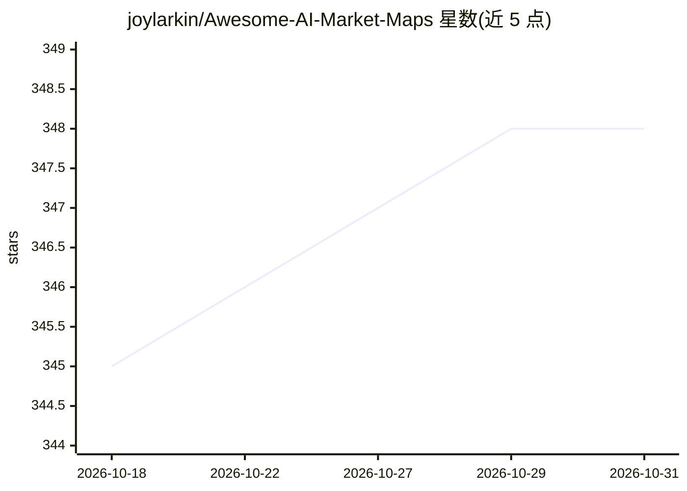

# joylarkin/Awesome-AI-Market-Maps

⭐ 348 · Python · MIT · 推送 2026-10-28 · [GitHub](https://github.com/joylarkin/Awesome-AI-Market-Maps) · 个人维护

**AI 创业市场图（market map）策展清单：500+ 张按季度组织**

个人维护的 Awesome List，收录 2026、2025 与 2024 年由 VC、行业分析师与 AI 从业者制作的 500 余张 AI 市场图/行业格局图。条目按季度与主题（AI Agents、AI Security、Physical AI、Healthcare AI 等）组织，数据收集流程使用 Claude、Exa Websets 与人工筛选，README 持续更新，配套 CSV 双月更新，并提供 MCP server、Hugging Face 数据集与 RSS 订阅等访问方式；接受 Pull Request、邮件与社交媒体提交新条目。

## 筛选速览

| 维度 | 判定 | 备注 |
|---|---|---|
| AI 角色 | `ai-knowledge` | 知识聚合/清单类 |
| 许可风险 | `permissive` | MIT |
| 部署形态 | `None` |  |
| 模型依赖 | — | README 未给出锁定关系 |
| 硬件要求 | — | 无带数字的原话,不猜 |
| 安装摩擦 | `low` | 无编译、无系统依赖或容器化 |
| 成熟度 | — | 结构信号不足 |

## 能力要点

- 收录 500+ 张来自 VC 与分析师的 AI 市场图
- 按季度与主题类别组织条目
- 配套 CSV（双月更新）、MCP server、Hugging Face 数据集与 RSS
- 通过 PR / Twitter / LinkedIn / 邮件接受条目提交

## 适用场景

- 跟踪各细分 AI 领域的创业公司格局
- 按季度回顾 AI 行业热点主题的演变
- 寻找特定领域（如 AI Security、Physical AI）的市场图来源

## 场景标签

`精选清单` · 领域:学习与行业

## 证据(README 行号)

> L3: An Awesome List of Artificial Intelligence Startup Market Maps from 2026, 2025 and 2024.
> L5: ***Now featuring over 500 AI Market Maps by top VCs, industry analysts, and AI practitioners.***

## 星数曲线

2026-10-18 345 → 2026-10-31 348（+3）

---
*卡片 v1 · prompt 1.4 · 生成 2026-10-21 · 置信度 high · 依据 README sha `c4c02e996e2b` · [字段定义](../../DATASET.md)*
