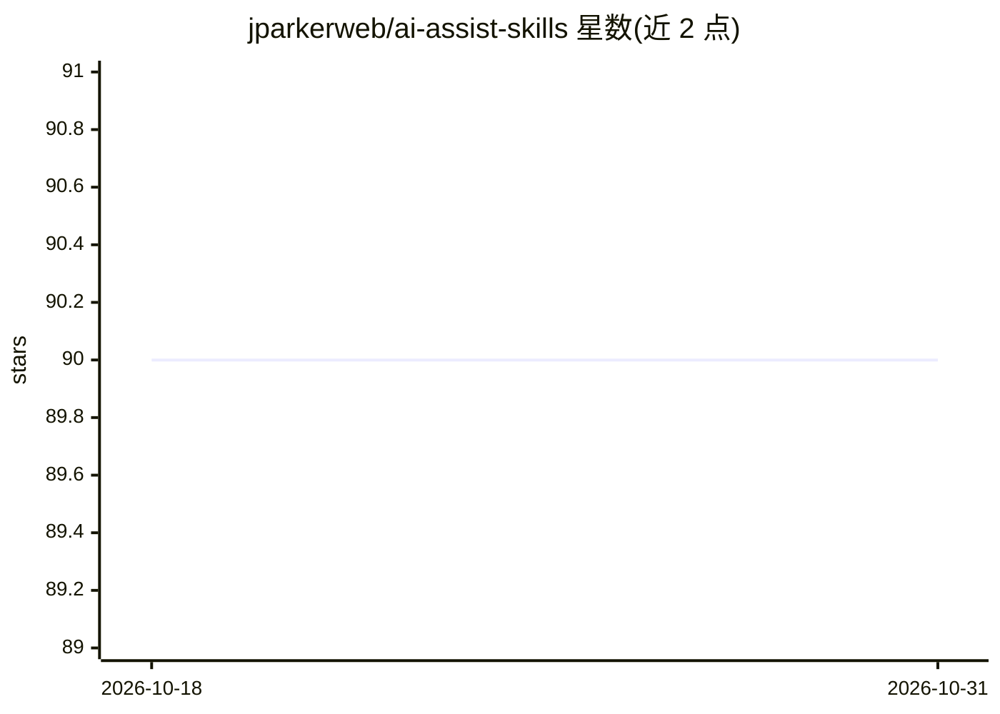

# jparkerweb/ai-assist-skills

⭐ 90 · HTML · 推送 2026-08-22 · [GitHub](https://github.com/jparkerweb/ai-assist-skills) · 个人维护

**可装到多个 AI 编码助手的工程工作流技能集合**

由个人维护的 AI agent 技能仓库，包含 16 个 ai-assist- 前缀技能，覆盖 CHANGELOG 版本管理、git 提交/PR 生命周期/代码审查/发布、网站设计系统逆向、深度调研、网站 Docker 化、依赖升级，以及安全/可观测性/技术债/测试套件的多维度审计。技能通过 npx skills 全局安装，可被 Claude Code、Cursor、Windsurf、GitHub Copilot 等 40+ agent 自动识别，在 agent 内以 /ai-assist- 命令调用。部分技能依赖 gh CLI 与 Docker 等外部工具。

## 筛选速览

| 维度 | 判定 | 备注 |
|---|---|---|
| AI 角色 | `ai-ecosystem` | LLM/agent 周边工具 |
| 许可风险 | `none` | — |
| 部署形态 | `self-host` | docker 或自建部署 |
| 模型依赖 | — | README 未给出锁定关系 |
| 硬件要求 | — | 无带数字的原话,不猜 |
| 安装摩擦 | `low` | 无编译、无系统依赖或容器化 |
| 成熟度 | — | 结构信号不足 |

## 能力要点

- 16 个 ai-assist- 前缀技能，覆盖版本管理、git 工作流与多维审计
- 一条 npx 命令同步安装全部技能并清理过期项
- 可被 40+ AI agent（Claude Code、Cursor、Windsurf、GitHub Copilot 等）自动检测
- git 类技能全部通过 gh CLI 操作，写入操作需预览与明确批准

## 适用场景

- 让 AI 编码助手自动完成提交、PR 创建与代码审查流程
- 对项目跑安全、可观测性、技术债或测试套件的多维审计
- 用深度调研技能分析代码库或技术选型可行性
- 把静态网站或文档目录容器化为 Docker 部署

## 场景标签

`编码 Agent` `代码审查` · 领域:编码与开发

## 证据(README 行号)

> L5: A collection of AI agent skills that automate recurring engineering workflows that can be installed across multiple 
> L17: Skills are installed globally via skills.sh and auto-detected by 40+ AI agents (Claude Code, Cursor, Windsurf, GitH

## 星数曲线

2026-10-18 90 → 2026-10-31 90（+0）

---
*卡片 v1 · prompt 1.4 · 生成 2026-10-23 · 置信度 mid · 依据 README sha `9c8c7d8172b8` · [字段定义](../../DATASET.md)*
