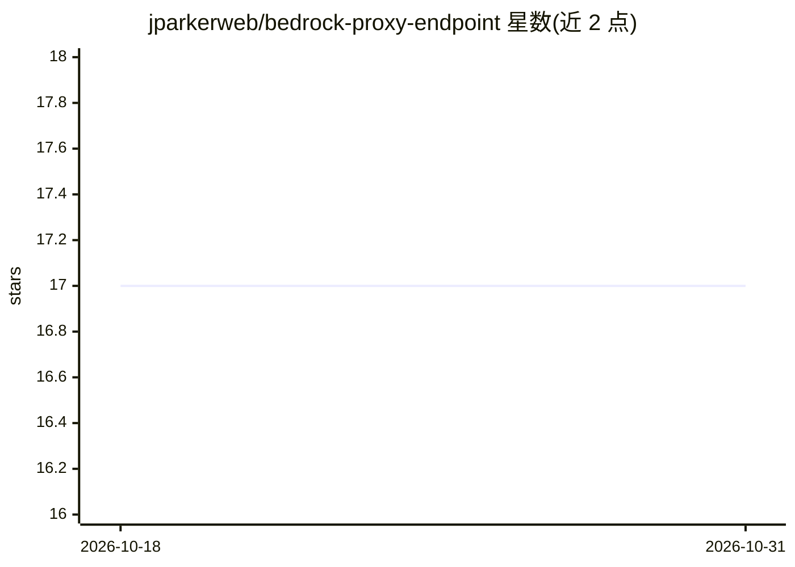

# jparkerweb/bedrock-proxy-endpoint

⭐ 17 · JavaScript · MIT · 推送 2026-04-16 · [GitHub](https://github.com/jparkerweb/bedrock-proxy-endpoint) · 组织维护

**自建 OpenAI 兼容端点，代理调用 AWS Bedrock 做文本推理**

Node.js 实现的代理服务器：以标准 OpenAI API 格式（baseUrl、apiKey、messages、model）接收请求，转换为 AWS Bedrock 调用完成文本推理，供希望保持平台无关的 Bedrock 用户复用现有 OpenAI 客户端。通过 IAM 凭证拼接进 apiKey 字段完成认证；支持 Converse API 切换、思考模型数据返回、stop 序列、HTTP/HTTPS 与 IP 限流配置。安装方式为 git clone 源码 + npm ci、Docker/GHCR 预构建镜像或 docker-compose；也可直接使用 npm 包 bedrock-wrapper 集成到代码库。

## 筛选速览

| 维度 | 判定 | 备注 |
|---|---|---|
| AI 角色 | `ai-ecosystem` | LLM/agent 周边工具 |
| 许可风险 | `permissive` | MIT |
| 部署形态 | `self-host` | docker 或自建部署 |
| 模型依赖 | locked-api |  |
| 硬件要求 | — | 无带数字的原话,不猜 |
| 安装摩擦 | `low` | 无编译、无系统依赖或容器化 |
| 成熟度 | — | 结构信号不足 |

## 能力要点

- OpenAI API 兼容端点代理 AWS Bedrock 文本推理
- apiKey 字段承载 AWS IAM 凭证（region.accessKey.secretKey 格式）
- 可选 Converse API、思考数据返回、stop 序列、vision 示例
- 提供 GHCR 预构建镜像与 docker-compose 部署方式

## 适用场景

- 已有 OpenAI 兼容应用直接切换到 AWS Bedrock 后端
- 避免针对 Bedrock SDK 的请求格式适配工作
- 统一多模型的调用格式并自建代理服务

## 场景标签

`模型网关` · 领域:Agent 开发

## 证据(README 行号)

> L2: Spin up your own custom OpenAI API server endpoint for easy AWS Bedrock LLM text inference (using standard `baseUrl`
> L15: - `Bedrock Proxy Endpoint` makes it easy to continue using the OpenAI API client that you are use to by standing up

## 星数曲线

2026-10-18 17 → 2026-10-31 17（+0）

---
*卡片 v1 · prompt 1.4 · 生成 2026-10-29 · 置信度 high · 依据 README sha `f873097d6f98` · [字段定义](../../DATASET.md)*
