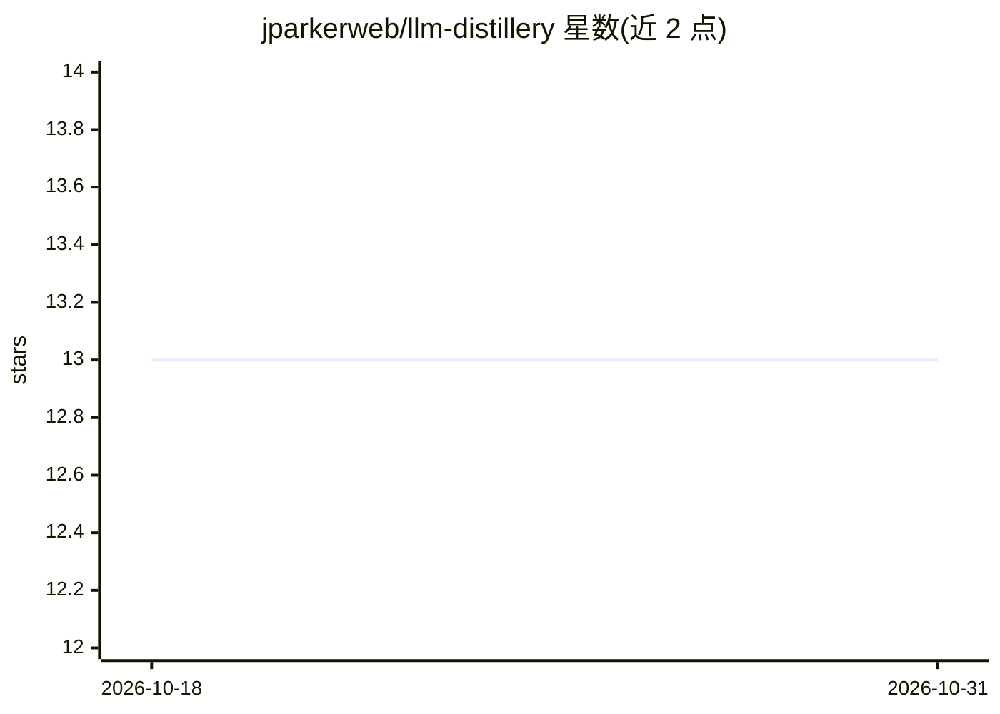

# jparkerweb/llm-distillery

⭐ 13 · JavaScript · 推送 2026-05-12 · [GitHub](https://github.com/jparkerweb/llm-distillery) · [官网](https://www.npmjs.com/package/llm-distillery) · 组织维护

**用 LLM 做 map-reduce 摘要把长文本压缩到目标 token 数的 Node 库**

面向 Node.js 开发者的 npm 库：对长文本做语义分块（依赖 semantic-chunking 库），对每块调用 OpenAI API 兼容的 LLM 生成摘要，再以 map-reduce 方式迭代压缩，直到达到目标 token 上限（默认 2048，最多 5 轮）。参数可配置目标 token 数、API base URL、模型标识、限速延迟等；支持 10 种 Xenova 系 tokenizer 模型（首次运行需下载缓存）。需自备 OpenAI 兼容端点的 API key，默认指向 together.ai 并使用 Llama-3-70b。附示例脚本与可本地运行的 Web Playground。

## 筛选速览

| 维度 | 判定 | 备注 |
|---|---|---|
| AI 角色 | `ai-ecosystem` | LLM/agent 周边工具 |
| 许可风险 | `none` | — |
| 部署形态 | `library` | 以包/库形式分发 |
| 模型依赖 | — | README 未给出锁定关系 |
| 硬件要求 | — | 无带数字的原话,不猜 |
| 安装摩擦 | `low` | 无编译、无系统依赖或容器化 |
| 成熟度 | — | 结构信号不足 |

## 能力要点

- map-reduce 迭代蒸馏直至满足目标 token 限制（默认 2048，最多 5 轮）
- 语义分块由 semantic-chunking 库完成，分块阈值可调
- 兼容任意 OpenAI API 兼容端点（默认 together.ai + Llama-3-70b）
- 提供 Web Playground 交互调试参数并导出配置

## 适用场景

- 长文档在送入 LLM 前压缩到上下文窗口内
- RAG 管线中控制输入文本的 token 预算
- 交互式调参并生成调用代码

## 场景标签

 · 领域:LLM 文本处理/工具库

## 证据(README 行号)

> L5: Use LLMs to distill large texts down to a manageable size by utilizing a map-reduce approach. This ensures that the 
> L15: - **Chunking and Summarization**: Uses the `semantic-chunking` library to intelligently split text into manageable 

## 星数曲线

2026-10-18 13 → 2026-10-31 13（+0）

---
*卡片 v1 · prompt 1.4 · 生成 2026-10-31 · 置信度 high · 依据 README sha `11bb3deb7113` · [字段定义](../../DATASET.md)*
