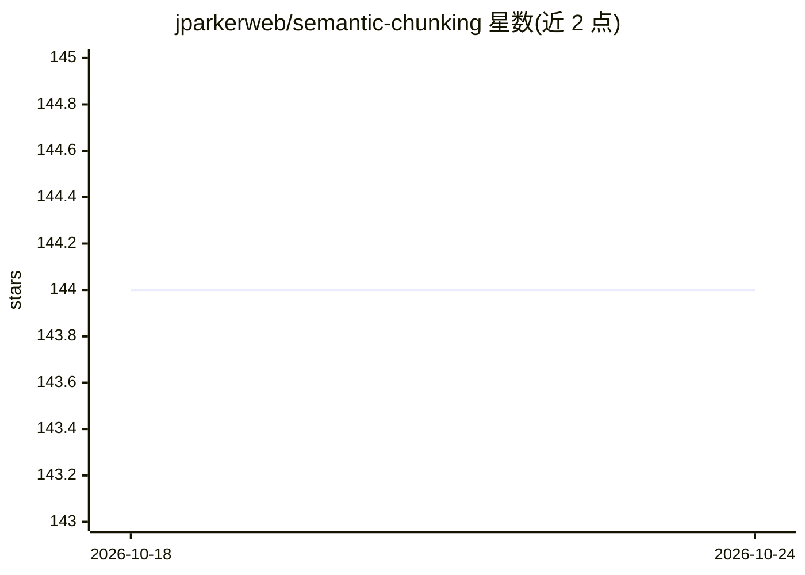

# jparkerweb/semantic-chunking

⭐ 144 · JavaScript · MIT · 推送 2026-08-14 · [GitHub](https://github.com/jparkerweb/semantic-chunking) · [官网](https://www.npmjs.com/package/semantic-chunking) · 组织维护

**面向 LLM/RAG 工作流的大文本语义分块 NPM 库**

eQuill Labs 维护的 Node.js 分块库：将文本拆分为句子，用本地 ONNX 嵌入模型生成向量，按余弦相似度阈值与最大 token 数将相邻句子聚合成块，可再平衡合并。默认模型 Xenova/all-MiniLM-L6-v2（自动下载 23-548MB），支持 q4-q8 量化与 webgpu。可通过 embedCallback 接入 OpenAI/Cohere 等自定义嵌入源。另提供 Web UI、Docker Compose 部署与 REST API 微服务（chunkit/cramit/sentenceit 端点、可选 Bearer 鉴权）。

## 筛选速览

| 维度 | 判定 | 备注 |
|---|---|---|
| AI 角色 | `ai-ecosystem` | LLM/agent 周边工具 |
| 许可风险 | `permissive` | MIT |
| 部署形态 | `self-host` | docker 或自建部署 |
| 模型依赖 | — | README 未给出锁定关系 |
| 硬件要求 | — | 无带数字的原话,不猜 |
| 安装摩擦 | `low` | 无编译、无系统依赖或容器化 |
| 成熟度 | — | 结构信号不足 |

## 能力要点

- 基于句子余弦相似度的语义分块，阈值与块大小可配置
- 本地 ONNX 嵌入模型，支持 fp32/fp16/q8/q4 与 cpu/webgpu
- embedCallback 可接入 OpenAI/Cohere 等自定义嵌入源
- 提供 Web UI 调参实验台与 REST API 微服务模式

## 适用场景

- 为 RAG 管道准备语义连贯的文本块
- 把分块能力作为微服务集成进应用
- 在 Web UI 中调参对比不同分块设置的效果

## 场景标签

`RAG` · 领域:知识与检索

## 证据(README 行号)

> L5: NPM Package for Semantically creating chunks from large texts. Useful for workflows involving large language models 
> L19: - Chunk prefix support for RAG workflows

## 星数曲线

2026-10-18 144 → 2026-10-24 144（+0）

---
*卡片 v1 · prompt 1.4 · 生成 2026-10-23 · 置信度 high · 依据 README sha `d2daad930ef9` · [字段定义](../../DATASET.md)*
