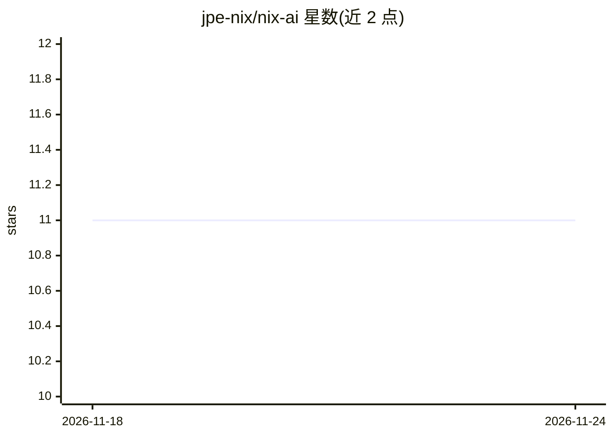

# jpe-nix/nix-ai

⭐ 11 · Nix · MIT · 推送 2026-11-24 · [GitHub](https://github.com/jpe-nix/nix-ai) · 个人维护

**Nix 声明式管理 AI 编码工具链与 MCP 服务器的 home-manager 模块**

以 Nix flake 形式提供的 home-manager 模块集合，将 Claude Code、Gemini/Antigravity、GitHub Copilot、OpenAI Codex、Qwen Code 等 AI 编码 CLI 的配置（插件、hooks、agents、权限规则）以及统一分发的 MCP 服务器目录声明为代码，实现跨机器可复现构建。默认配置全部启用，可选开启非信任 CLI 门控；macOS 上支持 MLX 本地推理常驻服务，并提供 Orca 桌面应用与 orca-server 的打包模块。要求 Nix flakes 与 home-manager，支持 aarch64-darwin 与 x86_64-linux。

## 筛选速览

| 维度 | 判定 | 备注 |
|---|---|---|
| AI 角色 | `ai-ecosystem` | LLM/agent 周边工具 |
| 许可风险 | `permissive` | MIT |
| 部署形态 | `None` |  |
| 模型依赖 | — | README 未给出锁定关系 |
| 硬件要求 | — | 无带数字的原话,不猜 |
| 安装摩擦 | `low` | 无编译、无系统依赖或容器化 |
| 成熟度 | — | 结构信号不足 |

## 能力要点

- 一个 flake 声明 Claude Code、Gemini、Copilot、Codex 等多个 AI 编码 CLI 配置
- 统一 MCP 服务器目录分发到所有 agent
- home-manager 模块零额外配置即可求值，依赖通过 _module.args 注入
- macOS 上提供 MLX 本地推理常驻服务与 launchd 集成

## 适用场景

- 换机后用一条命令完整重建 AI 编码工具配置
- 为团队统一分发 Claude Code 插件、规则与 MCP 服务器
- 在 Apple Silicon 上声明式管理本地 MLX 推理服务
- 将 AI CLI 配置纳入 NixOS/systemd 单元管理

## 场景标签

 · 领域:开发工具/环境配置管理

## 证据(README 行号)

> L8: ## Your AI coding toolkit, declared once. Reproduced everywhere
> L74: nix-ai exports home-manager modules
> L8: ## Your AI coding toolkit, declared once. Reproduced everywhere
> L12: setup as code using Nix. One command rebuilds everything,

## 星数曲线

2026-11-18 11 → 2026-11-24 11（+0）

---
*卡片 v1 · prompt 1.4 · 生成 2026-11-18 · 置信度 high · 依据 README sha `2c99ca2fbdb1` · [字段定义](../../DATASET.md)*
