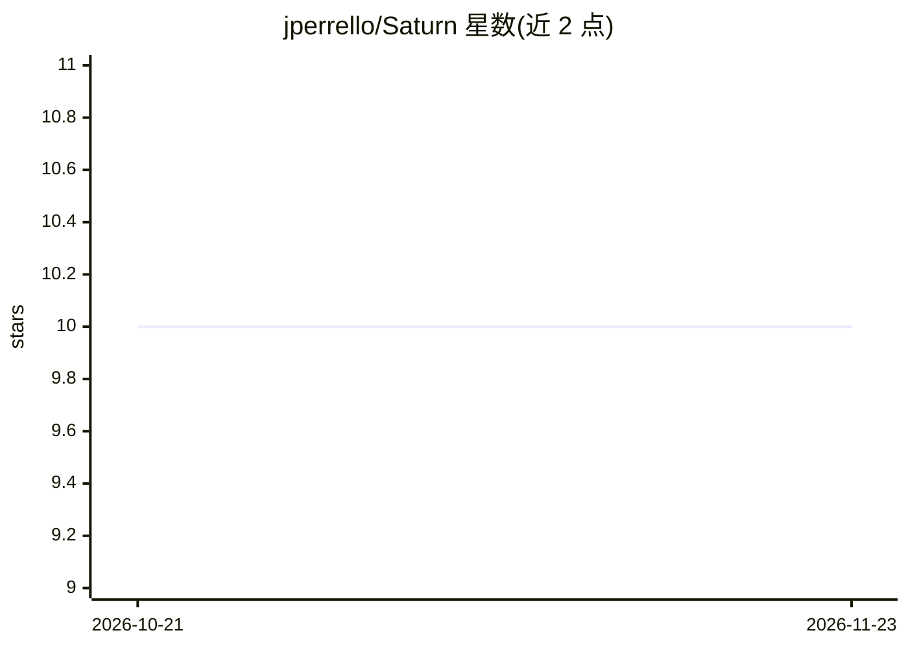

# jperrello/Saturn

⭐ 10 · Python · MIT · 推送 2026-05-20 · [GitHub](https://github.com/jperrello/Saturn) · [官网](https://jperrello.github.io/Saturn/) · 个人维护

**局域网内发现并调用 OpenAI 兼容 AI 端点的协议与实现集**

Saturn 定义了一个 mDNS/DNS-SD 服务类型 `_saturn._tcp.local.` 的协议，让局域网内的 OpenAI 兼容 AI 端点自行广播，客户端用 dns-sd/avahi 等标准工具发现并通过 /v1/health、/v1/models、/v1/chat/completions 调用。仓库为 UC Santa Cruz 硕士论文产物，含七种参考实现（Go/Python/Rust/TS/Lua），并提供 beacon 短期密钥与 proxy 两种凭据模式；协议面固定为浏览-解析-校验-排序-调用五步。macOS/Linux/Windows 平台各有依赖说明。

## 筛选速览

| 维度 | 判定 | 备注 |
|---|---|---|
| AI 角色 | `ai-ecosystem` | LLM/agent 周边工具 |
| 许可风险 | `permissive` | MIT |
| 部署形态 | `library` | 以包/库形式分发 |
| 模型依赖 | — | README 未给出锁定关系 |
| 硬件要求 | — | 无带数字的原话,不猜 |
| 安装摩擦 | `low` | 无编译、无系统依赖或容器化 |
| 成熟度 | — | 结构信号不足 |

## 能力要点

- 零配置：无账号、无逐应用密钥、无手工端点 URL
- 七种参考实现跨五语言四种 mDNS 库，仅靠线格式保证互操作
- beacon 模式下发短时效子密钥，proxy 模式由服务端持有父密钥
- TXT 记录携带 version/api_type/deployment 等协议字段

## 适用场景

- 在家庭或实验室局域网里让设备自动发现本地模型端点
- 给多个 OpenAI 兼容服务做优先级与故障转移路由
- 为 Open WebUI 等应用做发现后端替换
- ML 系统研究中做服务发现机制的原型验证

## 场景标签

 · 领域:网络/LLM 基础设施

## 证据(README 行号)

> L5: Saturn is a protocol — mDNS/DNS-SD service type `_saturn._tcp.local.` — that lets any OpenAI-compatible AI endpoint 
> L22: - **OpenAI-compatible by default.** Discovered endpoints expose `/v1/health`, `/v1/models`, `/v1/chat/completions`.
> L55: Seven reference clients across five languages and four mDNS libraries, sharing no Saturn-specific code. Interoperab

## 星数曲线

2026-10-21 10 → 2026-11-23 10（+0）

---
*卡片 v1 · prompt 1.4 · 生成 2026-11-19 · 置信度 high · 依据 README sha `2c0da1790df4` · [字段定义](../../DATASET.md)*
