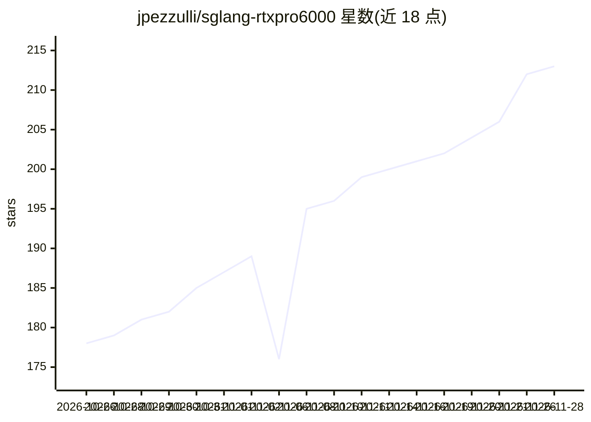

# jpezzulli/sglang-rtxpro6000

⭐ 213 · Python · Apache-2.0 · 推送 2026-11-27 · [GitHub](https://github.com/jpezzulli/sglang-rtxpro6000) · [官网](https://msoexpert.com) · 个人维护

**RTX PRO 6000 上运行 Qwen3.8 长上下文对话的 SGLang 推理运行时**

由 SGLang 派生的推理运行时，针对 NVIDIA RTX PRO 6000 Blackwell（SM120）单卡或双卡调优，提供两个模型配置档：Qwen3.8 Flash-Next（NVFP4）与 Qwen3.8-27B（FP8），两者均支持 524,288 token 上下文、工具调用、推理模式与图像输入。核心机制是三层会话缓存（GPU 显存、HiCache 系统内存、NIXL NVMe 磁盘），使长会话可从缓存历史恢复。推理加速采用 FR-Spec 与 NEXTN MTP/DFlash2 投机解码，KV 池按内存剖析自动定容。安装路径为预构建容器或源码原生构建。

## 筛选速览

| 维度 | 判定 | 备注 |
|---|---|---|
| AI 角色 | `ai-ecosystem` | LLM/agent 周边工具 |
| 许可风险 | `permissive` | Apache-2.0 |
| 部署形态 | `self-host` | docker 或自建部署 |
| 模型依赖 | — | README 未给出锁定关系 |
| 硬件要求 | — | 无带数字的原话,不猜 |
| 安装摩擦 | `low` | 无编译、无系统依赖或容器化 |
| 成熟度 | — | 结构信号不足 |

## 能力要点

- GPU/HiCache 内存/NIXL NVMe 三层会话缓存，支持服务重启后恢复对话状态
- 两个模型配置档：Qwen3.8 Flash-Next（NVFP4）与 Qwen3.8-27B（FP8），均支持 524K 上下文
- FR-Spec + NEXTN MTP/DFlash2 投机解码，draft 宽度按并发数固定路由
- KV 池按剖析内存自动定容，保留 MAX_TOTAL_TOKENS 显式设置

## 适用场景

- 在本地单卡 RTX PRO 6000 上跑长对话和编程 agent 工作流
- 跑工具调用密集的会话并从缓存恢复历史上下文
- 需要 524K token 长上下文的本地推理部署

## 场景标签

`推理引擎` `聊天机器人` `编码 Agent` · 领域:编码与开发

## 证据(README 行号)

> L5: Run long conversations, coding agents, and tool-heavy workflows on your own
> L6: hardware. Penny Royal is an SGLang-derived runtime tuned for **NVIDIA RTX PRO
> L9: **Persistent conversation caching is at the heart of Penny.** HiCache and NIXL

## 星数曲线

2026-10-26 178 → 2026-11-28 213（+35）

---
*卡片 v1 · prompt 1.4 · 生成 2026-11-25 · 置信度 high · 依据 README sha `21d98b2864ec` · [字段定义](../../DATASET.md)*
