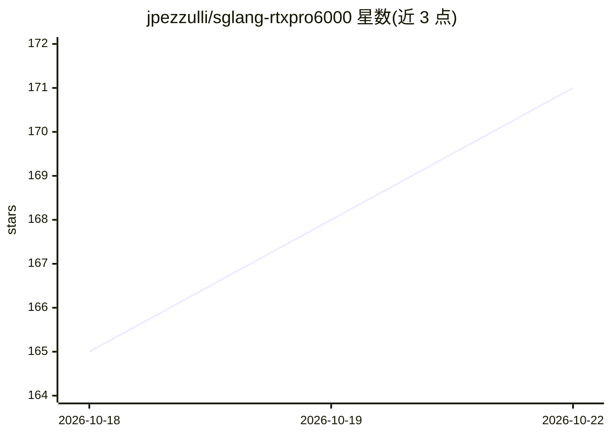

# jpezzulli/sglang-rtxpro6000

⭐ 175 · Python · Apache-2.0 · 推送 2026-10-22 · [GitHub](https://github.com/jpezzulli/sglang-rtxpro6000) · [官网](https://msoexpert.com) · 个人维护

**面向 RTX PRO 6000 Blackwell 的 SGLang 派生推理运行时**

Penny Royal 是从 SGLang 派生、针对单/双卡 NVIDIA RTX PRO 6000 Blackwell (SM120) 调优的 LLM 推理运行时，提供两个模型档：Qwen3.8 Flash-Next（NVFP4 专家+FP8 稠密层，FR-Spec 与自适应 MTP）与 Qwen3.8-27B FP8（DFlash2 投机解码）。核心机制为 GPU 显存/HiCache 内存/NIXL NVMe 三层会话缓存，支持 524K 上下文，可在服务器重启后恢复会话状态。安装分预构建容器与原生编译两条路径，需等待内核编译与 CUDA 图捕获。面向在自有硬件上运行长会话与编码 agent 的用户。

## 筛选速览

| 维度 | 判定 | 备注 |
|---|---|---|
| AI 角色 | `ai-ecosystem` | LLM/agent 周边工具 |
| 许可风险 | `permissive` | Apache-2.0 |
| 部署形态 | `None` |  |
| 模型依赖 | — | README 未给出锁定关系 |
| 硬件要求 | — | 无带数字的原话,不猜 |
| 安装摩擦 | `medium` | 含编译或系统依赖之一 |
| 成熟度 | `idea` | |

## 能力要点

- 524,288 token 上下文，TP1/TP2 两档硬件配置
- GPU/HiCache/NIXL 三层会话缓存，重启后可恢复缓存历史
- Flash-Next：FR-Spec + 自适应 MTP（C=1 时四/八 token 草稿切换）
- 27B：FP8 权重 + DFlash2 投机解码

## 适用场景

- 在单张 RTX PRO 6000 上本地运行长上下文编码 agent
- 跨会话复用数十万 token 的对话前缀缓存
- 搭建工具调用密集型工作流的自托管推理服务

## 场景标签

`推理引擎` · 领域:训练与推理

## 证据(README 行号)

> L6: hardware. Penny Royal is an SGLang-derived runtime tuned for **NVIDIA RTX PRO
> L9: **Persistent conversation caching is at the heart of Penny.** HiCache and NIXL

## 星数曲线

2026-10-18 165 → 2026-10-22 171（+6）

---
*卡片 v1 · prompt 1.4 · 生成 2026-10-22 · 置信度 high · 依据 README sha `4a8d1b4ff686` · [字段定义](../../DATASET.md)*
