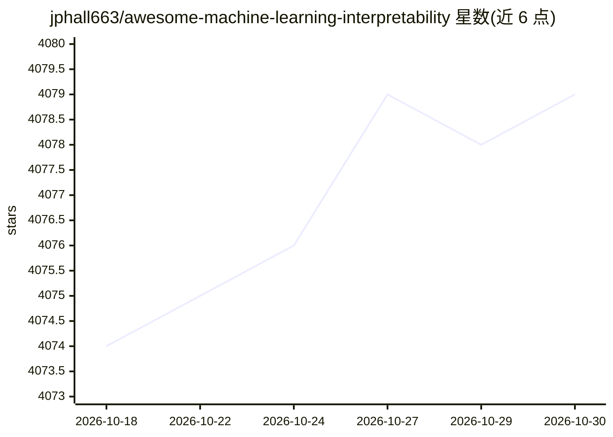

# jphall663/awesome-machine-learning-interpretability

⭐ 4,079 · CC0-1.0 · 推送 2026-06-03 · [GitHub](https://github.com/jphall663/awesome-machine-learning-interpretability) · 个人维护

**机器学习可解释性与负责任 AI 资源策展清单（已迁移）**

原为机器学习可解释性、AI 治理、公平性方向的资源策展清单。README 声明本仓库已重组进 HallResearch.ai Library，后者涵盖负责任 AI、AI 治理、机器学习评估、实施实践、政策、机构指南、事故与问责等资源，分“AI 治理与政策”和“AI 评估与实施”两个主分支。本仓库仅作延续性保留，内容见 archive 文件夹，后续更新将在 HallResearch.ai Library 仓库进行。

## 筛选速览

| 维度 | 判定 | 备注 |
|---|---|---|
| AI 角色 | `ai-knowledge` | 知识聚合/清单类 |
| 许可风险 | `viral` | CC0-1.0 |
| 部署形态 | `None` |  |
| 模型依赖 | — | README 未给出锁定关系 |
| 硬件要求 | — | 无带数字的原话,不猜 |
| 安装摩擦 | `low` | 无编译、无系统依赖或容器化 |
| 成熟度 | — | 结构信号不足 |

## 能力要点

- 策展机器学习可解释性与负责任 AI 相关资源
- 内容已重组并入 HallResearch.ai Library（两大主分支）
- 本仓库保留 archive 文件夹供延续性参考

## 适用场景

- 查找机器学习可解释性与 AI 治理方向的资料
- 了解负责任 AI 的政策与实施资源（需前往 HallResearch.ai Library）

## 场景标签

`精选清单` · 领域:学习与行业

## 证据(README 行号)

> L5: The HallResearch.ai Library is the current home for this project’s curated resources on responsible AI, AI governanc
> L15: - AI Governance and Policy Resources

## 星数曲线

2026-10-18 4,074 → 2026-10-30 4,079（+5）

---
*卡片 v1 · prompt 1.4 · 生成 2026-10-21 · 置信度 high · 依据 README sha `f4dc9650555a` · [字段定义](../../DATASET.md)*
