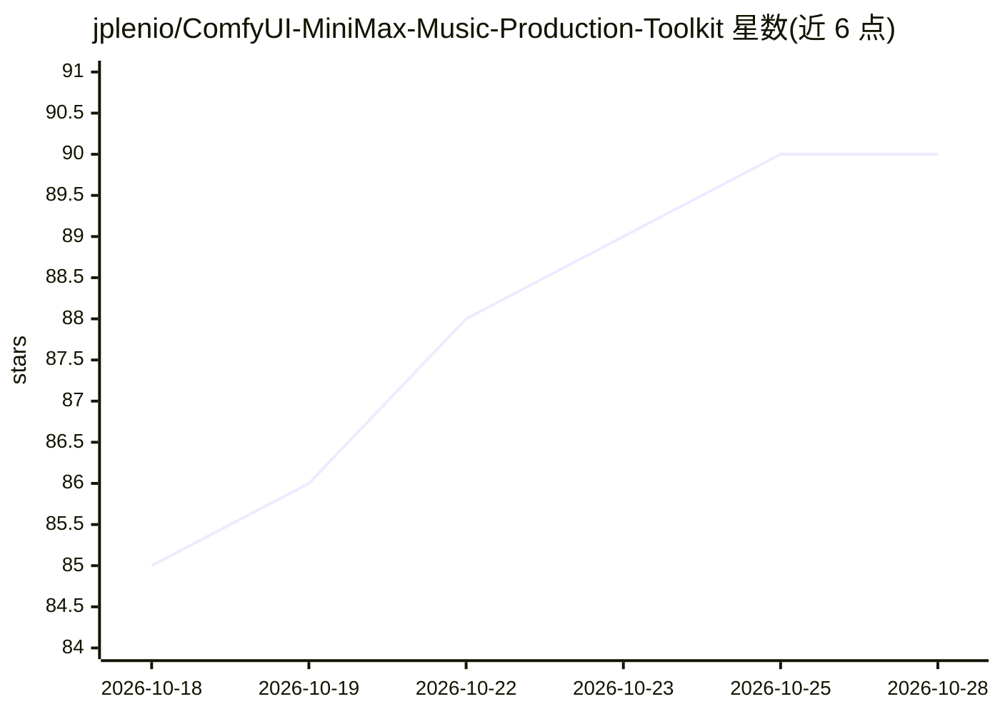

# jplenio/ComfyUI-MiniMax-Music-Production-Toolkit

⭐ 91 · Python · MIT · 推送 2026-09-20 · [GitHub](https://github.com/jplenio/ComfyUI-MiniMax-Music-Production-Toolkit) · 个人维护

**ComfyUI 本地音乐生产工具集：写歌、翻唱、修复、母带与封面**

面向 ComfyUI 的音乐生产自定义节点集合，覆盖从想法到成品的全流程：用 LLM 生成歌曲请求（编曲、同步歌词、标题与封面提示词），由 YuE2 或 MiniMax Music 3 渲染成曲；翻唱功能用 SheetSage2 从音频转写乐谱，经 ABC 重写、模型输出校验后由 YuE2 渲染新版本，Interpretation Freedom 滑杆控制改编幅度；另有去噪修复、EQ、母带处理及 FLAC/MP3 打标签导出。全部在本地运行，模型按需下载，支持自带任意本地或云端 LLM、faster-whisper 歌词转录与 FLUX.2 封面生成。由个人开发者维护。

## 筛选速览

| 维度 | 判定 | 备注 |
|---|---|---|
| AI 角色 | `ai-native` | 本体是模型或模型工具 |
| 许可风险 | `permissive` | MIT |
| 部署形态 | `library` | 以包/库形式分发 |
| 模型依赖 | local-ok | 支持本地模型 |
| 硬件要求 | `cpu-ok` | |
| 安装摩擦 | `low` | 无编译、无系统依赖或容器化 |
| 成熟度 | — | 结构信号不足 |

## 能力要点

- 从文字描述生成完整歌曲：编曲、歌词、标题与 FLUX.2 封面
- 翻唱链：SheetSage2 乐谱转写 + ABC 重写 + 模型输出校验 + 自由度滑杆（0-100）
- 音频修复与母带：去咔哒/削波、频带修复、Auto-EQ、FlashSR 超分、目标响度
- 器乐人声校验：转录渲染结果、数词数、按容差重试并保留最少人声版本

## 适用场景

- 用一句话描述生成带歌词、封面和元数据的完整歌曲
- 把已有音轨改编成翻唱版本，自由控制保留原曲的程度
- 对录音做修复、增强和母带处理并打标签导出

## 场景标签

`图像生成` `语音识别` · 领域:内容生成

## 证据(README 行号)

> L5: **A Swiss Army knife for local music production on ComfyUI.** Generate a song from
> L91: - **Write a song from a description.** Pick a template or write your own brief,
> L113: - **Bring your own models.** YuE2 and MiniMax Music 3 for songs, SheetSage2 for

## 星数曲线

2026-10-18 85 → 2026-10-28 90（+5）

---
*卡片 v1 · prompt 1.4 · 生成 2026-10-23 · 置信度 mid · 依据 README sha `b800bd08e2ca` · [字段定义](../../DATASET.md)*
