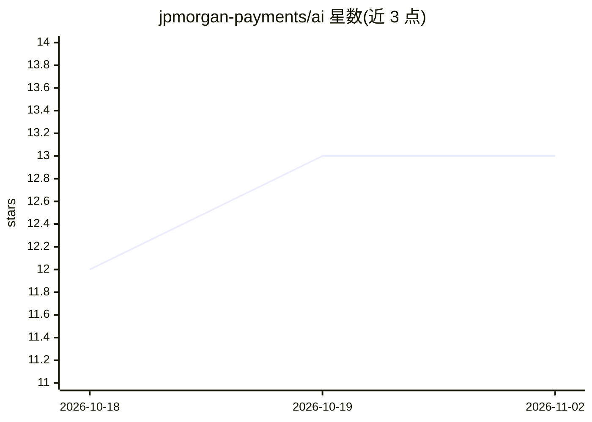

# jpmorgan-payments/ai

⭐ 13 · Python · Apache-2.0 · 推送 2026-11-01 · [GitHub](https://github.com/jpmorgan-payments/ai) · [官网](https://developer.payments.jpmorgan.com/) · 组织维护

**摩根大通支付 API 的 agent 技能与 MCP 文档服务工具包**

面向接入 J.P. Morgan Payments API 的开发者的工具仓库：包含两类组件——Agent Skills（引导 agent 完成开户、OAuth 认证与 Checkout、在线支付等 API 集成的过程性指南）和一个 MCP Server（提供对 Payments Developer Portal 全部文档的搜索、阅读与关联查找）。可通过 Claude Code、Codex、Cursor 的插件市场安装，或用 npx skills 手动安装。使用前需开发者账号与 API 凭证（clientId、证书、私钥），并声明所有 AI 生成代码须经工程师审核后才可上生产。

## 筛选速览

| 维度 | 判定 | 备注 |
|---|---|---|
| AI 角色 | `ai-ecosystem` | LLM/agent 周边工具 |
| 许可风险 | `permissive` | Apache-2.0 |
| 部署形态 | `library` | 以包/库形式分发 |
| 模型依赖 | — | README 未给出锁定关系 |
| 硬件要求 | — | 无带数字的原话,不猜 |
| 安装摩擦 | `low` | 无编译、无系统依赖或容器化 |
| 成熟度 | — | 结构信号不足 |

## 能力要点

- Agent Skills 覆盖 onboarding、OAuth 与多个支付 API 集成流程
- MCP Server 使 agent 可搜索/阅读 PDP 文档集
- 支持 Claude Code / Codex / Cursor 插件市场安装，自动更新
- 提供 /jpm-csr 命令生成 CSR 用于申请凭证

## 适用场景

- 让 AI agent 按官方流程完成支付 API 的认证与集成
- 在 agent 内直接检索 Payments 开发者文档
- 开发对接摩根大通支付服务的产品原型

## 场景标签

 · 领域:金融支付/开发者工具

## 证据(README 行号)

> L13: |**Agent Skills** — `skills/`|Procedural playbooks that walk your agent through onboarding, OAuth, and API integrat
> L14: |**MCP Server** — `mcp/`|A Model Context Protocol server that puts the entire PDP documentation set at your agent's

## 星数曲线

2026-10-18 12 → 2026-11-02 13（+1）

---
*卡片 v1 · prompt 1.4 · 生成 2026-10-31 · 置信度 high · 依据 README sha `42b7b62df3b2` · [字段定义](../../DATASET.md)*
