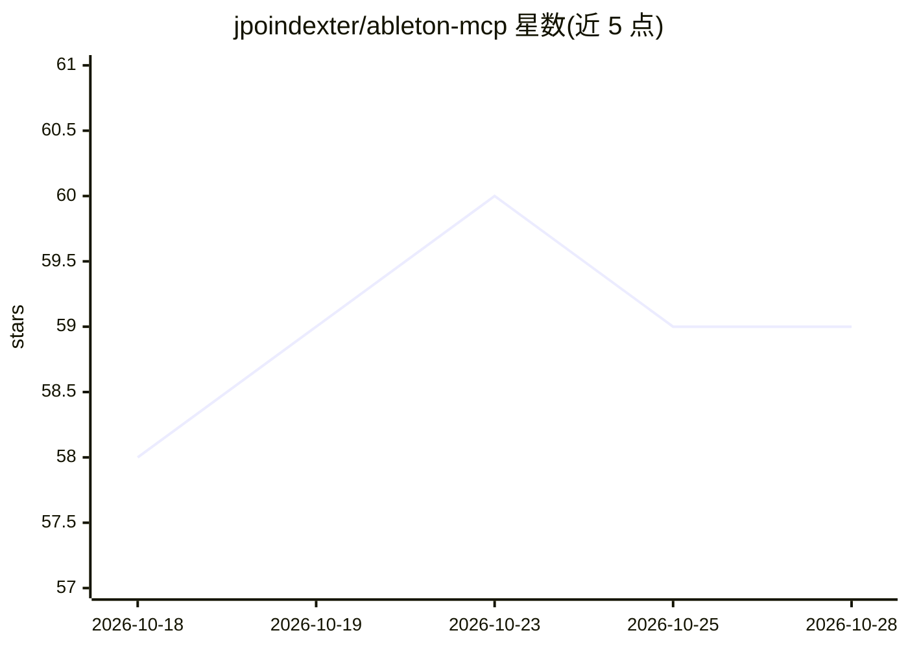

# jpoindexter/ableton-mcp

⭐ 59 · Python · MIT · 推送 2026-05-01 · [GitHub](https://github.com/jpoindexter/ableton-mcp) · [官网](https://github.com/jpoindexter/ableton-mcp) · 个人维护

**让 LLM 通过 MCP/REST 控制 Ableton Live 的工具集成（200+ 工具）**

将 Ableton Live 接入大模型的服务：提供 200+ 覆盖 Live Object Model 的工具，支持走轨/剪辑/MIDI/设备/混音等操作，以及鼓点与贝斯线生成等音乐辅助功能。提供三种接入方式：Claude Desktop/Cursor 的 MCP Server、供任意 LLM 使用的 REST API（Ollama/OpenAI/Groq 等）、以及 Ableton 内的 Max for Live 设备。需在 Ableton 中手动安装 Remote Script，通过 TCP 9877 端口通信。为第三方集成，非 Ableton 官方出品。

## 筛选速览

| 维度 | 判定 | 备注 |
|---|---|---|
| AI 角色 | `ai-ecosystem` | LLM/agent 周边工具 |
| 许可风险 | `permissive` | MIT |
| 部署形态 | `library` | 以包/库形式分发 |
| 模型依赖 | local-ok | 支持本地模型 |
| 硬件要求 | — | 无带数字的原话,不猜 |
| 安装摩擦 | `low` | 无编译、无系统依赖或容器化 |
| 成熟度 | — | 结构信号不足 |

## 能力要点

- 200+ 工具覆盖 Ableton Live Object Model（走轨、剪辑、MIDI、设备、混音、自动化等）
- 三种接入方式：MCP Server、REST API、Max for Live 设备
- REST API 支持任意 LLM 提供商，含 API key 认证、限流、分页与 OpenAI 兼容工具定义
- 内置鼓点（8 风格）与贝斯线（6 风格）生成、12+ 音阶查询等音乐辅助工具

## 适用场景

- 用 Claude 对话式地创建节拍、编曲和混音 Ableton 工程
- 用本地 Ollama 或 OpenAI/Groq 等任意 LLM 控制 Ableton Live
- 在 Ableton 内通过 Max for Live 设备直接与 AI 对话

## 场景标签

 · 领域:音乐制作/工具集成

## 证据(README 行号)

> L5: AbletonMCP connects Ableton Live to Claude AI through the Model Context Protocol (MCP), allowing Claude to directly 
> L14: |**REST API** (Ollama / OpenAI / Any LLM)|Any LLM, custom apps|Python, FastAPI|
> L318: Claude AI <-> MCP Server (Python/FastMCP) <-> Ableton Remote Script (Python)

## 星数曲线

2026-10-18 58 → 2026-10-28 59（+1）

---
*卡片 v1 · prompt 1.4 · 生成 2026-10-24 · 置信度 mid · 依据 README sha `0ca19e2a5923` · [字段定义](../../DATASET.md)*
