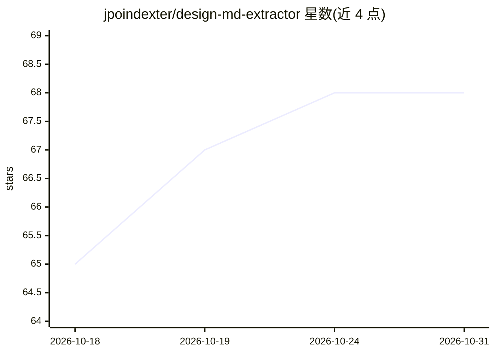

# jpoindexter/design-md-extractor

⭐ 68 · TypeScript · MIT · 推送 2026-06-07 · [GitHub](https://github.com/jpoindexter/design-md-extractor) · 个人维护

**从网站提取设计系统并生成 DESIGN.md 与设计 tokens 的工具**

输入 URL，用 Playwright 在桌面/平板/手机三种视口加载真实浏览器、滚动触发懒加载、触发 hover/focus 捕捉交互状态，读取计算样式并按出现频率排出置信度，输出 DESIGN.md、evidence.json、tokens.css、Tailwind 主题、W3C 设计 tokens、AI 提示词、预览页与截图。提供 CLI、本地 GUI 和 MCP server 三种使用方式；全程本地运行，不调用任何 AI、无需 API key。附 Claude Code skill 供 agent 按提取结果重建站点样式；支持 Cookie 文件与持久 Chrome profile 绕过 Cloudflare/登录墙。需要 Node.js ≥18.18 与 Playwright Chromium。

## 筛选速览

| 维度 | 判定 | 备注 |
|---|---|---|
| AI 角色 | `ai-enhanced` | 去掉 AI 部分产品仍成立 |
| 许可风险 | `permissive` | MIT |
| 部署形态 | `desktop` | 安装包/桌面程序 |
| 模型依赖 | — | README 未给出锁定关系 |
| 硬件要求 | — | 无带数字的原话,不猜 |
| 安装摩擦 | `low` | 无编译、无系统依赖或容器化 |
| 成熟度 | — | 结构信号不足 |

## 能力要点

- Playwright 多视口真实浏览器采集：颜色/字体/间距/组件/动效/交互状态
- 输出 DESIGN.md、W3C 设计 tokens、Tailwind 主题、CSS 变量、AI 提示词等多种格式
- MCP server 暴露 extract_design/list_runs/get_run 工具供任意 MCP 兼容 agent 调用
- Cookie 注入与持久 Chrome profile 两种方式处理 Cloudflare/登录墙

## 适用场景

- 把现有网站的设计系统转成 tokens 用于重建或复刻页面
- 让 AI 编码 agent 通过 MCP 调用提取流程并获得可直接消费的 DESIGN.md
- 为设计系统文档生成结构化的颜色/字体/间距参考

## 场景标签

`网页抓取` · 领域:效率与自动化

## 证据(README 行号)

> L7: > Fully local. It never calls an AI or needs an API key — the "AI Assistant" picker only chooses which prompt templa
> L105: The MCP server exposes the full extraction pipeline as tools so any MCP-compatible AI agent can call it — no GUI, 
> L211: ## Use with an AI coding agent (Claude Code skill)

## 星数曲线

2026-10-18 65 → 2026-10-31 68（+3）

---
*卡片 v1 · prompt 1.4 · 生成 2026-10-24 · 置信度 high · 依据 README sha `626e5457115b` · [字段定义](../../DATASET.md)*
